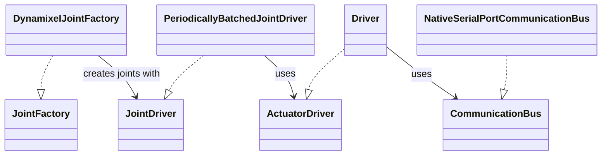

# Dynamixel

## Overview

The hardware adapter for Robotis Dynamixel XL430-W250 actuators. It implements
`RobotDomain`'s `ActuatorDriver` and `JointFactory` contracts on top of the
Dynamixel SDK's native C library, reached over an FTDI USB serial adapter. It
converts between register steps and `UnitsNet` quantities, and is the only
project that calls the native SDK.

## Responsibility

Adapt Dynamixel actuators and native serial communication to robot driver and joint contracts.

## Public APIs

`CommunicationBus`, `NativeSerialPortCommunicationBus`, `LowLevelCommunicationBusNativeInterop`, `Driver`, `DynamixelJointFactory`, `DynamixelJoint`, register/unit conversion types.

## Interface

All types are in namespace `Dynamixel`.

### Composition

- `DynamixelJointFactory(JointDriver)` (`DynamixelJointFactory.cs`):
  `JointFactory`, `IDisposable`.
  - `static Eff<DynamixelJointFactory> Create(CancellationTokenSource,
    TimeProvider, FatalErrorHandler)`: opens the bus with
    `NativeSerialPortCommunicationBus.CreateInitialized`, then wires a `Driver`,
    a `JointStateCacheDictImpl` and a `PeriodicallyBatchedJointDriver` into a
    factory. Fails with the bus's error when the port cannot be opened.
  - `New(Link parent, Link child, Transform passiveTransform, JointId,
    RobotDomain.Structures.RotationDirection, AttachmentOrder)`: creates a
    `DynamixelJoint` and calls its `Initialize` before returning it.
  - `Dispose()`: disposes the joint driver. It does not dispose the
    `NativeSerialPortCommunicationBus` that `Create` opened, so the port stays
    open.
- `DynamixelJoint` (`Dynamixeljoint.cs`): `Joint` whose `State` reads
  `JointDriver.GetState(id)`, whose `SetAngleGoal(Timed<Angle>)` calls
  `JointDriver.SetGoalAngleFor(id, goal)`, and whose `Initialize()` calls
  `JointDriver.Initialize(id, RotationDirection)`. Nothing in it is specific to
  Dynamixel (its TODO says so).

### Actuator driver

- `Driver(CommunicationBus)` (`Driver.cs`): `ActuatorDriver` in actuator units.
  - `Initialize(ActuatorId, RobotDomain.Structures.RotationDirection)`: reboots
    the actuator if `CommunicationBus.Ping` returns `false` (never with
    `NativeSerialPortCommunicationBus`; see Common Pitfalls), logs a non-zero `HardwareErrorStatus`, disables
    torque, writes `ProfileVelocity` (0.5 rev/s, rounded up to whole steps), the
    `DriveMode` direction bit, position P/I/D gains (500, 200, 4000) and
    `ReturnDelayTime` 0, then enables torque.
  - `ReadAngles(IEnumerable<ActuatorId>)`: one group read of `PresentPosition`.
  - `SetGoalAngles(IReadOnlyDictionary<ActuatorId, Angle>)`: one group write of
    `GoalPosition`.
  - `ReadAngle`, `ReadAngleGoal`, `ReadSpeed`, `ReadTemperature`,
    `ReadLoadRatio` (`ActuatorId`): single reads of `PresentPosition`,
    `GoalPosition`, `PresentVelocity`, `PresentTemperature` and `PresentLoad`.
  - `RotateAt(ActuatorId, RotationalSpeed)`: throws `NotImplementedException`.

### Communication bus

- `CommunicationBus` (`CommunicationBus.cs`): `IDisposable` interface for
  register access: group `Write(IReadOnlyDictionary<Id, uint>, ControlRegister)`
  and `Read(IEnumerable<Id>, ControlRegister)`, single `Write(Id,
  ControlRegister, uint)` and `Read(Id, ControlRegister)`, `Reboot(Id)` and
  `Ping(Id)`.
- `NativeSerialPortCommunicationBus` (`NativeSerialPortCommunicationBus.cs`):
  the native `CommunicationBus`, protocol 2.0. Its constructor is private.
  - `static Eff<NativeSerialPortCommunicationBus> CreateInitialized()`: opens
    the FTDI device with serial number `FT2H2YMW`, requests 1 ms latency (see Common Pitfalls),
    reads its COM port name and closes it; then creates the SDK port and packet
    handlers, opens the port (`FailedToOpenPortException` on failure), sets
    4,000,000 bit/s and a 2 ms packet timeout.
  - Group reads and writes use SDK sync groups, one per `ControlRegister`,
    created on first use. An empty group write or read touches no port; the
    read returns an empty dictionary. A group write throws `Exception` when an
    ID cannot be added to the group; a group read throws `Exception` when an ID
    cannot be added or no data is available for it after the transfer.
  - Single reads and writes support 1, 2 and 4 byte registers and throw
    `NotSupportedException` for other sizes.
  - `Dispose()`: closes the port.
- `LowLevelCommunicationBusNativeInterop`
  (`LowLevelCommunicationBusNativeInterop.cs`): `public static` `DllImport`
  bindings to `Lib\dxl_x64_c_4_0_2.dll` (port handler, packet handler, sync and
  bulk groups), copied from the Dynamixel SDK; Windows only.

### Registers and units

- `ControlRegister(Name, Area, Address, SizeInBytes, Access, InitialValue)`
  (`ControlRegister.cs`): record with one static property per XL430-W250
  register used here, from `ModelNumber` (address 0) to `IndirectData56`
  (address 661).
- `Id(int)` (`Id.cs`): `ActuatorId` for a Dynamixel ID; `Broadcast` (254),
  `FromBase(ActuatorId)`, implicit conversion to `byte`.
- `StepAngle` (`StepAngle.cs`): `StepCenter` (2,048), `ToAngle(uint)`,
  `ToSteps(Angle)`.
- `DynamixelRotationalSpeed(uint Value)` (`DynamixelRotationalSpeed.cs`):
  `StepSize` (0.229 rpm), `Infinite` (0), `FromRotationalSpeed(RotationalSpeed)`,
  which rounds up to the next step.
- `RotationDirection(uint Value)` (`RotationDirection.cs`): `Forward` (0),
  `Reverse` (1), `FromDomain(RobotDomain.Structures.RotationDirection)`.
- `PortNumber(int Value)` (`PortNumber.cs`): SDK port handle.
- `FailedToOpenPortException(PortNumber?)` (`FailedToOpenPortException.cs`):
  LanguageExt `Expected` error, code 0.
- Internal: `GroupNumber` (SDK group handle), `StepSpeed.ToSpeed(uint)`
  (steps × 0.229 rpm), `StepTemperature.ToTemperature(uint)` (one step per
  degree Celsius).

### Non-code assets

- `Lib/dxl_x64_c_4_0_2.dll`: native SDK library, copied to the output's `Lib`
  folder by `Dynamixel.csproj`.
- `XL430_W250_control_table.csv`: the actuator's control table, the reference
  for `ControlRegister` addresses. No code loads it.

## Key Concepts

IDs, control registers, batched reads/writes, motor angle and speed conversion.

## Class relationships

The factory creates a joint driver backed by a Dynamixel driver and communication bus. The bus interface keeps native port access replaceable; arrows below denote implementation or use, not project references.

## Dependencies

`Generic`, `RobotDomain`, and native/vendor packages in `Dynamixel.csproj`
(`FTDI.FTD2XX_NET`; `CsvHelper` is referenced but no code uses it).

## Dependency Rules

Keep native SDK calls within this adapter; higher-level code should use stable contracts.

## Invariants

`NativeSerialPortCommunicationBus` serializes operations on its port; preserve lock coverage for shared native state. Every public operation except `Dispose`, and the lazy creation of its sync groups, runs under one lock, because the SDK keeps the last result per port and `CheckCommunicationResults` reads it after each call. `Dispose` closes the port without the lock, so dispose the bus only after every caller has stopped using it.

`Id` accepts 0 to 254 and throws `ArgumentOutOfRangeException` otherwise. `RotationDirection.FromDomain` throws `ArgumentOutOfRangeException` for an unknown direction.

`StepAngle` maps XL430 position steps 0 to 4,095 (4,096 counts per revolution, 0.088 degrees per count, center step 2,048) to angles from -0.5 up to, but not including, 0.5 revolutions, and rounds an angle to the nearest step. Every step the actuator can report round-trips through `ToAngle` and `ToSteps`, including both ends of the range. `ToSteps` throws `ArgumentException` for an angle outside that range. Source: Robotis e-Manual, XL430-W250 control table.

`Driver.Initialize` owns each actuator's Drive Mode register: it writes the rotation direction to bit 0 (0 normal, 1 reverse) and clears every other bit, whatever the actuator had stored. Bit 2 must stay clear (velocity-based profile), because the velocity limit is written to `ProfileVelocity` as a speed; with bit 2 set the actuator reads it as a move duration in ms. Source: Robotis e-Manual, XL430-W250 Drive Mode (address 10).

`Driver.Initialize` sends the EEPROM writes (`DriveMode`, `ReturnDelayTime`) after the torque-disable write, and enables torque last. It does not check that torque is off: with `NativeSerialPortCommunicationBus` a failed torque-disable write is only logged, and the actuator can then reject the EEPROM writes, which is also only logged, so the stored direction stays unchanged without any error.

The velocity limit stays finite (0.5 rev/s): `Driver` notes that a high or infinite limit made the motors reset on big movements.

## Side Effects

- `NativeSerialPortCommunicationBus.CreateInitialized` opens and closes the FTDI
  device, then opens the serial port and keeps it open until the bus's
  `Dispose`. It logs to the console when opening the port and setting the
  baud rate succeed. `DynamixelJointFactory` never
  calls that `Dispose` (see
  [physical tests leak the serial adapter](../knowledge/root-causes/physical-tests-leak-the-serial-adapter.md)).
- Every `CommunicationBus` operation sends packets on the serial bus. Writes to
  `GoalPosition` and `TorqueEnable` move or hold the robot.
- `Driver.Initialize` reboots an actuator whose ping returns `false`, blocking
  for 300 ms and then pinging again with delays doubling from 0.1 s while the
  delay is under 5 s (it does not fail if the actuator stays silent). With
  `NativeSerialPortCommunicationBus` the ping never returns `false`, so this
  path never runs. It writes EEPROM
  (`DriveMode`, `ReturnDelayTime`) and RAM registers and enables torque.
- `DynamixelJointFactory.New` initializes the actuator through the joint driver,
  so with a real driver creating a joint enables its torque.
- `NativeSerialPortCommunicationBus.Reboot` retries once after a 1 s sleep when
  the first attempt throws.
- `NativeSerialPortCommunicationBus` and `Driver` write diagnostics (failed
  results, hardware errors, reboots) to the console.
- SDK sync groups are created per register on first use and never released.

## Architectural Constraints

Opening ports and enabling/moving motors are explicit hardware actions; do not run casually.

## Common Pitfalls

- [Physical runs](../knowledge/pitfalls/physical-runs.md); uncoordinated port access can corrupt communication.
- `CheckCommunicationResults` logs a failed transmission or packet error to the
  console and does not throw. A failed single read returns whatever the SDK
  returned, and `Ping` returns `true` even for a silent actuator, so
  `Driver.Initialize` never reboots one and goes on to enable torque.
- `StepSpeed.ToSpeed` and `Driver.ReadLoadRatio` take the raw `uint` register
  value; `ToSpeed` applies no sign conversion.
- The interop class's remarks name SDK v3.8.4; the bundled library is
  `dxl_x64_c_4_0_2.dll`.
- `CreateInitialized` finds the adapter by FTDI serial number and a Windows COM
  port name; it works only on Windows with that adapter.
- `CreateInitialized` asks the FTDI device for 1 ms latency, but its comment
  records that this does not change the COM port's latency; set it by hand in
  Windows Device Manager.

## Verification

- Run: `dotnet test Test\Test.csproj --filter "FullyQualifiedName~Test.Unit.Dynamixel"`
  (hardware-free; uses `EchoJointDriver` and Moq mocks of `CommunicationBus`).
- `Test.Integration.Dynamixel` tests are `PhysicalRobotFact`/`PhysicalRobotTheory`
  and move the robot: run them only after the operator confirms the robot, port
  and operating conditions.

## Related ADRs

[Hardware boundary](../docs/adr/0002-hardware-adapter-boundary.md), [Test tiers](../docs/adr/0005-test-tiers-for-physical-and-simulated-runs.md)

## Related Findings

[MaydayDomain reference](../knowledge/findings/mayday-domain-hardware-reference.md), [Right coxa direction mismatch](../knowledge/findings/right-coxa-direction-mismatch.md).

## Related Root Causes

[Interpolation baseline drift](../knowledge/root-causes/interpolation-baseline-drift.md), [Step angle counts](../knowledge/root-causes/step-angle-4094-counts.md), [test host crash](../knowledge/root-causes/test-host-crash-from-scheduler-failfast.md), [physical tests leak the serial adapter](../knowledge/root-causes/physical-tests-leak-the-serial-adapter.md)

## Related Lessons Learned

[Goal versus measured state](../knowledge/lessons-learned/goal-versus-measured-state.md), [Tests must discriminate](../knowledge/lessons-learned/tests-must-discriminate.md)

## Related Failed Attempts

[Measured-angle interpolation](../knowledge/failed-attempts/measured-angle-interpolation.md).
