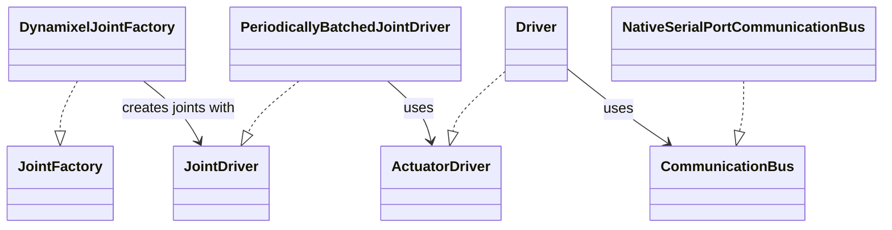

# Dynamixel

## Responsibility

Adapt Dynamixel actuators and native serial communication to robot driver and joint contracts.

## Public APIs

`CommunicationBus`, `NativeSerialPortCommunicationBus`, `Driver`, `DynamixelJointFactory`, register/unit conversion types.

## Key Concepts

IDs, control registers, batched reads/writes, motor angle and speed conversion.

## Class relationships

The factory creates a joint driver backed by a Dynamixel driver and communication bus. The bus interface keeps native port access replaceable; arrows below denote implementation or use, not project references.

## Dependencies

`Generic`, `RobotDomain`, and native/vendor packages in `Dynamixel.csproj`.

## Dependency Rules

Keep native SDK calls within this adapter; higher-level code should use stable contracts.

## Invariants

`NativeSerialPortCommunicationBus` serializes operations on its port; preserve lock coverage for shared native state.

`StepAngle` maps XL430 position steps 0 to 4,095 (4,096 counts per revolution, 0.088 degrees per count, center step 2,048) to angles from -0.5 up to, but not including, 0.5 revolutions, and rounds an angle to the nearest step. Every step the actuator can report round-trips through `ToAngle` and `ToSteps`, including both ends of the range. Source: Robotis e-Manual, XL430-W250 control table.

`Driver.Initialize` owns each actuator's Drive Mode register: it writes the rotation direction to bit 0 (0 normal, 1 reverse) and clears every other bit, whatever the actuator had stored. Bit 2 must stay clear (velocity-based profile), because the velocity limit is written to `ProfileVelocity` as a speed; with bit 2 set the actuator reads it as a move duration in ms. Source: Robotis e-Manual, XL430-W250 Drive Mode (address 10).

## Architectural Constraints

Opening ports and enabling/moving motors are explicit hardware actions; do not run casually.

## Common Pitfalls

[Physical runs](../knowledge/pitfalls/physical-runs.md); uncoordinated port access can corrupt communication.

## Related ADRs

[Hardware boundary](../docs/adr/0002-hardware-adapter-boundary.md), [Test tiers](../docs/adr/0005-test-tiers-for-physical-and-simulated-runs.md)

## Related Findings

[MaydayDomain reference](../knowledge/findings/mayday-domain-hardware-reference.md), [Right coxa direction mismatch](../knowledge/findings/right-coxa-direction-mismatch.md).

## Related Root Causes

[Interpolation baseline drift](../knowledge/root-causes/interpolation-baseline-drift.md), [Step angle counts](../knowledge/root-causes/step-angle-4094-counts.md), [test host crash](../knowledge/root-causes/test-host-crash-from-scheduler-failfast.md), [physical tests leak the serial adapter](../knowledge/root-causes/physical-tests-leak-the-serial-adapter.md)

## Related Lessons Learned

[Goal versus measured state](../knowledge/lessons-learned/goal-versus-measured-state.md), [Tests must discriminate](../knowledge/lessons-learned/tests-must-discriminate.md)

## Related Failed Attempts

[Measured-angle interpolation](../knowledge/failed-attempts/measured-angle-interpolation.md).
