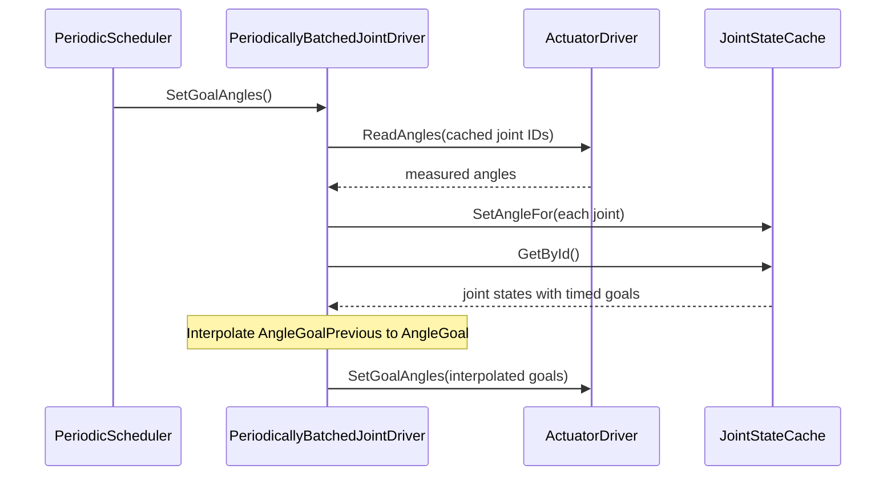

# Shared motion

## Responsibility

Define planning and actuator-driving contracts plus periodic batched drivers.

## Interface

- **Planning:** `MotionPlanner<TState>`, once started with `Start(CancellationToken)`, continuously tracks its `Goal` (`Option<Timed<TState>>`) by planning and executing a trajectory, and exposes the current `Plan` (`MotionPlanner.cs`). `MotionPlan<TState>.At(DateTimeOffset)` gives the state planned for a time (`MotionPlan.cs`). `LinearStepsMotionPlan<TState>(IEnumerable<Timed<TState>> Steps)` returns the first step arriving after the time, otherwise the last step (`LinearStepsMotionPlan.cs`).
- **Actuator port:** `ActuatorDriver` is the device-independent port that hardware adapters outside this project implement (`ActuatorDriver.cs`). `Initialize(ActuatorId, RotationDirection)`, batched `ReadAngles` and `SetGoalAngles`, single-actuator reads (`ReadAngle`, `ReadAngleGoal`, `ReadSpeed`, `ReadLoadRatio`, `ReadTemperature`), and `RotateAt(ActuatorId, RotationalSpeed)`. `ActuatorId` is an interface with `int Value` (`ActuatorId.cs`).
- **Joints:** `JointDriver : IDisposable` with `Initialize(JointId, RotationDirection)`, `GetState(JointId)` and `SetGoalAngleFor(JointId, Timed<Angle>)` (`JointDriver.cs`). Its implementation, `PeriodicallyBatchedJointDriver(ActuatorDriver, JointStateCache, CancellationTokenSource, TimeProvider, FatalErrorHandler, TimeSpan? updatePeriod = null)`, writes goals to a cache and sends them to the actuators in one batch per period (`PeriodicallyBatchedJointDriver.cs`):
  - `Initialize`: initializes the actuator and seeds the cache from values read from it.
  - `SetGoalAngleFor`: writes the goal to the cache only; the next period sends it.
  - `GetState`: reads the cache.
  - `Dispose`: cancels the token source and waits for the periodic loop to end.
- **Joint state cache:** `JointStateCache`, with `GetIds`, `GetById`, `GetFor`, `SetFor`, `SetAngleFor` and `SetAngleGoalFor`, and its `ConcurrentDictionary` implementation `JointStateCacheDictImpl` (`JointStateCache.cs`, `JointStateCacheDictImpl.cs`).
- **Wheels:** `WheelDriver` with `Initialize(WheelId, RotationDirection)` and `RotateAt(WheelId, Timed<RotationalSpeed>)` (`WheelDriver.cs`). `PeriodicallyBatchedWheelDriver(ActuatorDriver)` forwards `Initialize` to the actuator (`PeriodicallyBatchedWheelDriver.cs`). `WheelId(int)` names `FrontLeft` (0), `RearLeft` (1), `FrontRight` (2) and `RearRight` (3) (`WheelId.cs`).

## Key Concepts

- **Layers of ports:** a `MotionPlanner` decides where the robot should be, a `JointDriver` or `WheelDriver` moves its joints or wheels, and an `ActuatorDriver` talks to the devices. An implementation of one layer uses the port of the layer below, as `PeriodicallyBatchedJointDriver` uses `ActuatorDriver`.
- **Timed goals:** a goal is a `Timed<Angle>`, a target with the time it was issued and the time it should be reached. Each period moves a joint one step from its previous commanded goal toward its current goal, by how much of that time has passed (`Timed.StepFactor`).
- **Goal, not measurement:** interpolation starts from the previous *commanded* goal. The measured angle is cached for feedback only and never becomes the baseline. See the [measured-angle baseline pitfall](../../knowledge/pitfalls/interpolation-baseline.md).
- **Batching:** one period reads every joint's angle in one call and writes every joint's goal in one call, so a period costs two device round trips however many joints there are.

## Joint update sequence

The diagram describes one periodic update after initialization; the measured angle is cached for feedback, while interpolation uses the previous and current *commanded* goals rather than rebasing on the sensor reading.

## Dependencies

Part of `RobotDomain`. Uses:
- `RobotDomain.Structures` for joint ids, joint state and rotation direction;
- `RobotDomain.Time` for `Timed`, `PeriodicScheduler` and `FatalErrorHandler`;
- `RobotDomain.Physics` for `LoadRatio`;
- `UnitsNet` for every physical quantity, `LanguageExt` for `Option`, and `Generic` for collection helpers.

Concrete adapters implement device I/O elsewhere.

## Dependency Rules

Never import native device or vendor operations into shared drivers.

## Invariants

`PeriodicallyBatchedJointDriver` synchronizes driver access and uses previous commanded goal for interpolation.

- **Each period:** under `lock (_driver)`, read the angles of all cached joints and store them with `SetAngleFor`. Then interpolate every cached joint's goal (`JointState.InterpolateGoalAngleOneTimeStep` with `Timed.StepFactor` at `TimeProvider.GetUtcNow()`), and send one `ActuatorDriver.SetGoalAngles` batch. `updatePeriod` defaults to 20 ms.
- **Locking:** `Initialize` takes the same lock as a period; `GetState` and `SetGoalAngleFor` take none and rely on the cache's own thread safety.
- **Initialization:** `Initialize` must come before any other call for a joint; otherwise `GetState` throws `KeyNotFoundException` and `SetGoalAngleFor` throws `NotSupportedException`. The periodic loop drives only initialized joints. `Initialize` seeds both `AngleGoal` and `AngleGoalPrevious` with `Timed.Passed` of the actuator's current goal angle.
- **Cache:** updates are atomic per joint (`AddOrUpdate`). `SetAngleGoalFor` moves the old goal to `AngleGoalPrevious` only when the new goal's `ArrivalTime` differs; otherwise it replaces `AngleGoal` alone. `GetById` returns a read-only view of the live dictionary, not a snapshot.
- **Ownership:** `PeriodicallyBatchedJointDriver` owns the `CancellationTokenSource` it is given. `Dispose` cancels it and waits for the loop. A cancelled loop task is ignored; any other fault from it is rethrown.
- **Plans:** `LinearStepsMotionPlan.At` throws `InvalidOperationException` for empty `Steps`.

## Known Issues

- `Dispose` disposes the token source only when the loop task completes without faulting or being cancelled: [MAY-92: Need: PeriodicallyBatchedJointDriver disposes its token source on every Dispose path](https://linear.app/mayday-robot/issue/MAY-92).
- A call for an uninitialized joint throws instead of being ignored: [MAY-97: Need: A joint driver call for an uninitialized joint does not fail](https://linear.app/mayday-robot/issue/MAY-97).
- `PeriodicallyBatchedWheelDriver.RotateAt` always throws `NotImplementedException`, and despite its name the class does nothing periodically or in batches: [MAY-96: Need: No public RobotDomain member throws NotImplementedException](https://linear.app/mayday-robot/issue/MAY-96).
- Motion and Structures depend on each other: [MAY-98: Need: Motion and Structures depend in one direction only](https://linear.app/mayday-robot/issue/MAY-98).
- `LinearStepsMotionPlan` does not check that its steps are non-empty, ordered and unique in time (TODO in code).

## Side Effects

- The `PeriodicallyBatchedJointDriver` constructor starts a background `PeriodicScheduler` loop, with its process-wide priority and timer effects (see [Time](../Time/README.md)). Errors from a period go to the injected `FatalErrorHandler`.
- Actuator I/O through the injected `ActuatorDriver`: reads at `Initialize`, then `ReadAngles` and `SetGoalAngles` every period; `PeriodicallyBatchedWheelDriver.Initialize` forwards to it.
- `Initialize` and each period lock on the injected `ActuatorDriver` object (`lock (_driver)`), so a joint is never initialized in the middle of a period. Any other code that locks on the same `ActuatorDriver` object waits for the periodic loop and can deadlock with it.
- Shared mutable state: the `JointStateCache`, written by the periodic loop and by callers.
- `Dispose` blocks until the periodic task ends.

## Verification

`dotnet test Test\Test.csproj --filter "FullyQualifiedName~Test.Unit.RobotDomain.Motion"`

## Architectural Constraints

Periodic cadence and cancellation affect motion safety; review before changing them.

## Common Pitfalls

[Measured-angle baseline](../../knowledge/pitfalls/interpolation-baseline.md).

## Related ADRs

[Hardware boundary](../../docs/adr/0002-hardware-adapter-boundary.md).

## Related Findings

[Scheduler construction](../../knowledge/findings/scheduler-constructed-inside-domain-classes.md)

## Related Root Causes

[Interpolation drift](../../knowledge/root-causes/interpolation-baseline-drift.md), [Test host crash](../../knowledge/root-causes/test-host-crash-from-scheduler-failfast.md)

## Related Lessons Learned

[Goal versus measured state](../../knowledge/lessons-learned/goal-versus-measured-state.md).

## Related Failed Attempts

[Measured-angle interpolation](../../knowledge/failed-attempts/measured-angle-interpolation.md).
