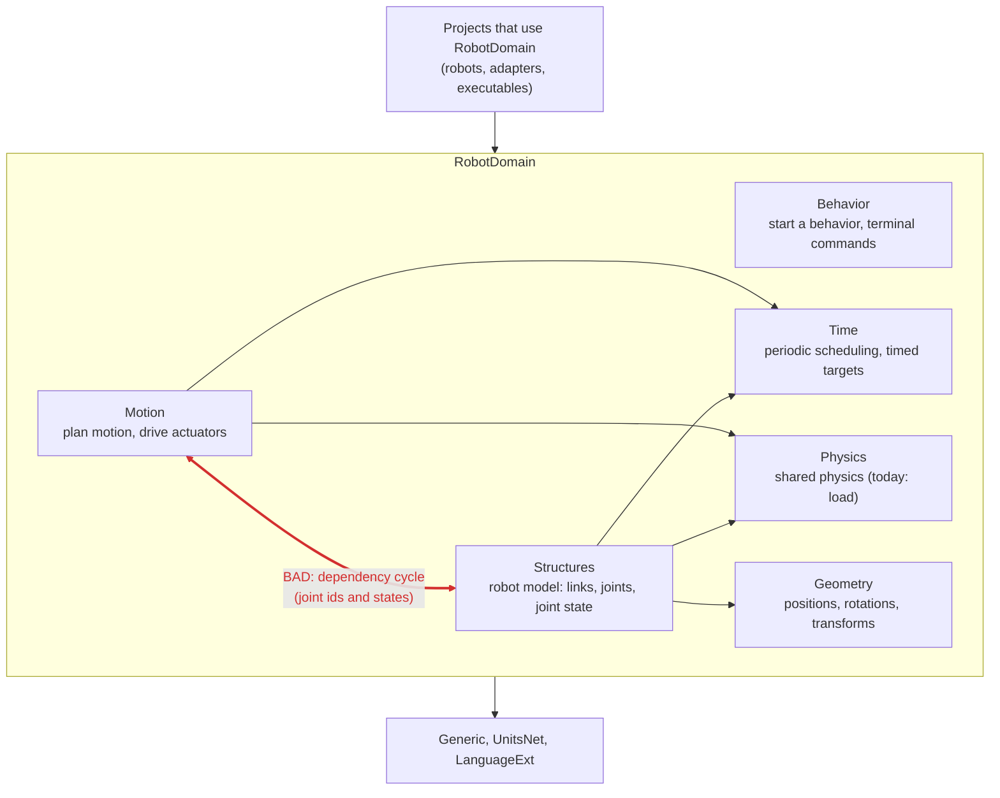

# RobotDomain

## Responsibility

Shared robotics vocabulary, structures, motion contracts, behavior contracts, geometry, and timing.

## Subdirectories & System Boundaries

The public API is the root types of each namespace below; each README holds its full contract.

- Behavior: [README](Behavior/README.md) - robot behavior shared by any robot; today `BehaviorController` and the abstract, blocking `TerminalBehaviorController<TCommand>` loop that reads enum commands from an injected `Terminal`, which is to move out ([MAY-109: Need: Terminal user interface lives outside RobotDomain](https://linear.app/mayday-robot/issue/MAY-109)).
- Geometry: [README](Geometry/README.md) - immutable, unit-typed `Xyz`, `Q`, `Rpy`, `Transform`, `Twist`, `Ray3D` and `Triangle3D`, with `float` math underneath.
  - Geometry/SystemNumerics: [README](Geometry/SystemNumerics/README.md) - unitless `float` `Ray3`, `Triangle3` and `Vector3Extensions` behind the geometry types.
- Motion: [README](Motion/README.md) - planner, plan and driver ports (`MotionPlanner`, `MotionPlan`, `ActuatorDriver`, `JointDriver`, `WheelDriver`), the joint state cache, and `PeriodicallyBatchedJointDriver`, which sends interpolated goals to the actuators in one batch per period.
- Physics: [README](Physics/README.md) - physics shared by any robot; today only `LoadRatio`, an actuator load as a UnitsNet `Ratio`.
- Structures: [README](Structures/README.md) - the `Link`/`Connection` kinematic tree, `Joint` and `EchoJoint`, `JointFactory`, `JointState` and the identity types.
- Time: [README](Time/README.md) - anything time related; today `PeriodicScheduler`, the Windows timer resolution setting and `Timed<T>`, plus `FatalErrorHandler`/`FailFastFatalErrorHandler`, which are to move out ([MAY-106: Need: Fatal error handling lives outside RobotDomain.Time](https://linear.app/mayday-robot/issue/MAY-106)).

### Dependency flow

Each arrow points from a namespace to one it uses. Dependencies flow down, from moving the robot through its model to the foundations, and never out to the projects that use this one.



- **Bad (red):** Motion and Structures depend on each other. The motion ports take joint ids and joint states, and a joint id is an actuator id. The cycle couples the two namespaces, so neither can change or be understood on its own. Do not add to it; break it, so that dependencies only flow one way.
- Behavior uses no other namespace here; it only defines how a behavior starts and how terminal commands reach it.
- Geometry, Physics and Time use nothing else in this project. Geometry's `SystemNumerics` folder holds its `float` helpers.

## Key Concepts

Joint/link graphs, units-aware state, timed goals, planners, drivers, periodic scheduling.

## Dependencies

`Generic` and the packages `UnitsNet` and `LanguageExt` (`RobotDomain.csproj`); no reference to any robot, adapter or executable project.

## Dependency Rules

Never depend on concrete robot projects, entry points, or hardware libraries. This project, and its documentation, stays ignorant of which robots use it.

## Global Invariants

Physical dimensions use explicit units; hardware creation stays outside this layer.

- Hardware is reached only through injected ports (`Motion.ActuatorDriver`, `Structures.JointFactory`, `Generic.Terminals.Terminal`); this project constructs no device.
- Time comes from a caller-supplied `TimeProvider` in `PeriodicScheduler` and `PeriodicallyBatchedJointDriver`.
- Interpolation starts from the previous commanded goal, never the measured angle (`JointState.InterpolateGoalAngleOneTimeStep`, used each period by `PeriodicallyBatchedJointDriver`).
- An exception from a periodic action goes to the injected `FatalErrorHandler`; composition roots that drive a real robot pass `FailFastFatalErrorHandler`.
- Value types (`Xyz`, `Q`, `Rpy`, `Transform`, `JointState`, `Timed<T>`, the ids) are immutable records; mutable state lives in `Link`, `EchoJoint` and the `JointStateCache`.

## Global Side Effects

- Process-wide on first use of `PeriodicScheduler`: process priority set to `High`, and Windows timer resolution set to 1 ms (`timeBeginPeriod`), restored only on `ProcessExit` ([Time](Time/README.md)).
- `FailFastFatalErrorHandler` ends the process with `Environment.FailFast`.
- `PeriodicallyBatchedJointDriver` runs a busy-spinning background loop that reads and writes actuators through the injected `ActuatorDriver` ([Motion](Motion/README.md)).
- Console output from `PeriodicScheduler` overruns, the fail-fast handler and `HighResolutionWindowsTimerSetting`; terminal I/O from `TerminalBehaviorController` through the injected `Terminal`.

## System Verification

```powershell
dotnet build RobotDomain\RobotDomain.csproj
dotnet test Test\Test.csproj --filter "FullyQualifiedName~Test.Unit.RobotDomain"
```

A change here reaches every project that references this one: also build the solution and run the test projects of those dependents, as the **Commands** section of the [root `CLAUDE.md`](../CLAUDE.md) lists.

## Architectural Constraints

[ADR 0001](../docs/adr/0001-stable-robot-abstractions.md) defines intended dependency direction.

## Common Pitfalls

Changing timing or interpolation without lagging-joint tests can change real motion.

## Related ADRs

[Stable abstractions](../docs/adr/0001-stable-robot-abstractions.md), [hardware boundary](../docs/adr/0002-hardware-adapter-boundary.md).

## Related Findings

None recorded.

## Related Root Causes

[Interpolation baseline drift](../knowledge/root-causes/interpolation-baseline-drift.md).

## Related Lessons Learned

[Goal versus measured state](../knowledge/lessons-learned/goal-versus-measured-state.md).

## Related Failed Attempts

[Measured-angle interpolation](../knowledge/failed-attempts/measured-angle-interpolation.md).
