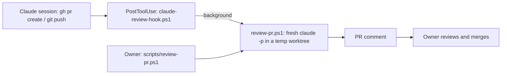

# Local Claude review of every pull request

## Status

Accepted. Extends [ADR 0006](0006-run-quality-gates-locally.md) with an advisory review that, like the gate, runs locally. The reviewer's tool boundary is amended by [ADR 0012](0012-pr-reviewer-reads-linear.md): it may also read Linear.

## Context

Most pull requests are written by a Claude Code session. That session reviews its own work only from the inside: it shares the assumptions that produced the change. The owner reviews and merges every pull request, and wants a second, independent reading before doing so. [ADR 0006](0006-run-quality-gates-locally.md) keeps checks off GitHub Actions, and the owner wants the review local too, for now.

## Decision

- `scripts/review-pr.ps1 [-PullRequest <n>] [-Force]` reviews a pull request: it checks the head commit out into a temporary worktree, runs a fresh headless `claude -p` session there and posts its output with `gh pr comment`. The session has no history of the authoring session. Its tools are limited to reading files and `gh pr diff|view`, `git diff|log|show`; it cannot edit, push, approve or merge. It loads user settings only (`--setting-sources user`), so the project's hooks (the Stop gate, the review hook) do not run in it.
- The prompt makes the reviewer read `CLAUDE.md`, the touched projects' `CLAUDE.md` and `README.md`, the relevant ADRs and `knowledge/INDEX.md`, and review against them: correctness, physical safety, units, architecture, the test ledger, documentation and commit conventions.
- A Claude Code `PostToolUse` hook (`scripts/claude-review-hook.ps1`, on `Bash|PowerShell`) starts `review-pr.ps1` in a hidden background process after a command that runs `gh pr create` or `git push`, and returns at once. It reviews the pull request of the branch checked out in the command's working directory, so pushes from any worktree are covered. Each run logs to its own file in `<git common dir>/claude-reviews`.
- Draft and closed pull requests are skipped. Each head commit is reviewed once: a marker in `<git common dir>/claude-reviews` records it, so repeated pushes of the same commit cost nothing. A failed review records nothing and is retried on the next trigger.
- The review is advisory. It is not a status check and blocks nothing; the gate stays `scripts/gate.ps1`. The comment is posted with the owner's `gh` login and the model usage is the owner's Claude login.

## Alternatives Considered

- A GitHub Actions workflow with `anthropics/claude-code-action`: reaches every pull request regardless of where it was pushed from, and can post inline comments, but runs remotely, needs the Claude GitHub app and a `CLAUDE_CODE_OAUTH_TOKEN` secret, and goes against keeping checks local for now. The natural next step if pull requests start coming from elsewhere.
- Review inside the authoring session (`/code-review`, a subagent): cheap, but not independent; it inherits the author's context and blind spots.
- Trigger from git's `pre-push` hook: covers pushes from a terminal too, but runs before the push lands, so the pull request does not yet have the new head (or does not exist yet), and it would slow every push.
- `/code-review ultra`: deeper multi-agent review, but started by hand and billed per run; remains available for large changes.

## Why

Independence needs a session that did not write the change; a fresh headless session in its own checkout of the head commit gives that, and keeps working while the author edits. Triggering from the authoring session's own `gh pr create` and `git push` covers how pull requests are made here without any remote infrastructure.

## Consequences

- Benefits: every pull request pushed by a Claude session gets an independent review against the repository's own rules before the owner reads it; no secrets, app or runner.
- Costs: Claude usage per reviewed commit on the owner's login; a background process on the development machine.
- Limitations: pushes from a terminal or IDE are not reviewed automatically; run `scripts/review-pr.ps1` for those. The review stops if the machine sleeps or shuts down mid-review (the next push retries). The comment is posted as one summary, not inline comments, and appears under the owner's GitHub account. The reviewer reads code and does not run it, so it does not replace the gate; its findings can be wrong and the owner decides. The scripts are covered by `scripts/Tests/ClaudeReview.Tests.ps1` with `gh` and `claude` replaced; the real `claude -p` call and the detached process are exercised only by use.

## Related Components

[scripts](../../scripts/README.md), [repository root](../../README.md)

## Related ADRs

[0006](0006-run-quality-gates-locally.md), [0007](0007-infrastructure-code-is-tested-like-product-code.md)

## Related Findings

None recorded.

## Related Root Causes

None recorded.
