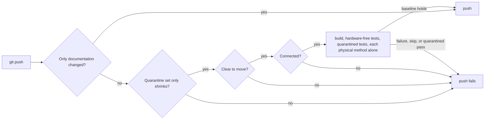

# The pre-push gate drives the robot

## Status

Accepted. Supersedes, for the pre-push hook only, "never as a merge gate" in [ADR 0005](0005-test-tiers-for-physical-and-simulated-runs.md) and "the gate never drives the robot" in [ADR 0006](0006-run-quality-gates-locally.md). The Claude Code Stop hook keeps ADR 0006's hardware-free gate.

## Context

Physical tests skip themselves unless the robot is clear to move, and the gate excluded them, so a run without the robot looked green and no push ever ran one. Running them by hand was easy to skip, and was skipped: progress on how the real robot moves was anchored in nothing ([MAY-80](https://linear.app/mayday-robot/issue/MAY-80)).

A run on the robot on 2026-10-24 showed what an honest gate meets:

- The tests never release the robot's serial adapter. In one test process only the first physical test can open it; every later one fails with `FT_DEVICE_NOT_OPENED` ([MAY-81](https://linear.app/mayday-robot/issue/MAY-81)).
- One physical theory fails on its own ([MAY-82](https://linear.app/mayday-robot/issue/MAY-82)), and several tests were skipped permanently.

## Decision

- A push that changes anything besides documentation (Markdown, `docs/`, `knowledge/`, `Media/`) runs `scripts/gate.ps1 -Physical` in Release: every `Test` test except `Tier=Manual`, the physical tier included. A documentation-only push runs nothing.
- The gate fails before building unless the robot is **clear to move** (`MAYDAY_ROBOT_IS_CLEAR_TO_MOVE` is `True`, read with the tests' precedence: user secrets over environment) and **connected** (Mayday's FTDI adapter is present and its port opens). The flag is the operator's standing confirmation; Claude never sets it.
- Each physical test method runs in a dotnet test process of its own, so a leaked port cannot fail the next test. The hardware-free and quarantined hardware-free tests run as one process each.
- Known failures are the `[Quarantine]` set ([ADR 0004](0004-quarantine-failing-tests-with-a-trait.md)), and it can only shrink. Before anything else the gate runs `scripts/quarantine-ratchet.ps1`: it fails when the committed branch adds `[Quarantine]`, the `Quarantine` trait or `Skip =` to a test that exists at its merge-base with `origin/master`, or quarantines a new test without naming the `MAY-` issue that will fix it.
- A skipped test fails the push, quarantined or not. A test that is not quarantined fails it by failing. A quarantined test fails it by passing: its `[Quarantine]` must come off. The gate runs every test run and reports every such test before failing.
- A physical pass is remembered against the working tree like any gate pass, apart from the hardware-free pass, so pushing an unchanged tree again does not move the robot again.

## Diagram (if helpful)

## Alternatives Considered

- Keep physical tests manual: the cost being removed.
- Ask the operator in a prompt window before each physical run ([ADR 0009](0009-manual-robot-tests-confirmed-by-a-human.md)'s prompt): stronger per-run consent, but the owner chose the standing flag, so a push needs no extra step while the robot is set up.
- Trust the flag alone, without the connected check: a stale flag would let a push fail later with device errors, or pass with nothing attached to drive.
- A baseline file of known failures instead of `[Quarantine]`: it drifts from the code, as ADR 0004 found.
- A ratchet on the count of quarantined tests: a regression could hide behind a fix in the same push.
- Run the physical tier in one process: shorter, but results depend on which test opens the adapter first, so the baseline would flip between runs.
- Gate physical tests in the Stop hook too: every Claude turn would move the robot.

## Why

The gate is where a skipped check becomes impossible to skip quietly; the owner wants the physical tier there, accepting slower pushes and a robot attached for every code push. Requiring both a flag and a port check separates the statement only a person can make (the robot may move) from the fact the software can check (it is there). One process per method costs a few seconds per method and buys deterministic results until the tests release the adapter themselves.

## Consequences

- Benefits: every code push is checked on the real robot; a known failure stays visible and its fix is noticed at once; a regression cannot be quarantined away.
- Costs: pushes take longer, roughly a dotnet test start per physical method plus the moves; a code push needs the robot attached and clear to move.
- Limitations: `git push --no-verify` still bypasses the hook. The connected check knows Mayday's adapter serial number, a copy of the one in `NativeSerialPortCommunicationBus`, and is Windows only. The ratchet reads attributes by pattern, not by compiling: it knows `[Quarantine(...)]`, `[Trait("Quarantine", ...)]` and `Skip =` inside a test attribute, and a renamed test, or one moved to another namespace, counts as new (tests are keyed `Namespace.Class.Method`). It does not see an existing test moved to `Tier=Manual` (`[ManualRobotFact]` or `[Trait("Tier", "Manual")]`), which takes it out of every gate run, nor an existing test that is deleted; both are review points. Landing a new baseline needs a pull request merged before the ratchet sees it, as MAY-80's own baseline did. The documentation-only check lists a renamed file by its new path only, so moving a code file into `docs/` counts as documentation. The clear-to-move check maps a quoted `"true"` secret to `True`, which the tests read as not clear to move. It also takes the first matching line of the secrets file, while the tests' reader skips `//` comments and lets a repeated key's last value win. In both cases the push fails with every physical test skipped rather than with the flag message. The gate tests the working tree, not the pushed commits; they are the same for the usual push of a clean `HEAD`. Manual tests stay by hand.

## Related Components

[scripts](../../scripts/README.md), [Test](../../Test/README.md), [Dynamixel](../../Dynamixel/README.md)

## Related ADRs

[0004](0004-quarantine-failing-tests-with-a-trait.md), [0005](0005-test-tiers-for-physical-and-simulated-runs.md), [0006](0006-run-quality-gates-locally.md), [0007](0007-infrastructure-code-is-tested-like-product-code.md), [0009](0009-manual-robot-tests-confirmed-by-a-human.md)

## Related Findings

None recorded.

## Related Root Causes

None recorded.
