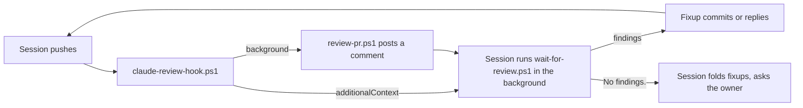

# The authoring session follows the review until it is clean

## Status

Accepted. Amends how the authoring session treats the review of [ADR 0010](0010-local-claude-review-of-every-pull-request.md); the review itself stays advisory to the owner.

## Context

[ADR 0010](0010-local-claude-review-of-every-pull-request.md) has a separate Claude session review every pushed head and post a comment. The session that pushed was told to "answer its findings but do not wait on it". In practice it never heard about the review: the hook announced it on plain stdout, which Claude Code shows for a `PostToolUse` hook only in the transcript, never to Claude. Findings sat unanswered until the owner came to review ([MAY-84: Need: The automatic code review comments are addressed before agent asks me to review.](https://linear.app/mayday-robot/issue/MAY-84)). Each push of fixes starts a new review, which can find more, so one pass is not enough.

## Decision

- After `gh pr create` or `git push`, `claude-review-hook.ps1` returns its message as `hookSpecificOutput.additionalContext`, which reaches the session. It tells the session to run `scripts/wait-for-review.ps1` in the background, address every finding (a fixup commit, or a reply on the pull request saying why not), push, and wait again until a review of the head says `No findings.`. Only then does the session fold its fixups and ask the owner to review.
- `wait-for-review.ps1` waits for `review-pr.ps1`'s marker for the pull request and the working tree's `HEAD` in `<git common dir>/claude-reviews`, prints the posted review and exits 0. It exits 1 when the review of that head failed (`review-pr.ps1` now marks a failure with `<n>-<sha>.failed`) or none arrived within 60 minutes (longer than `review-pr.ps1`'s wait for the head plus a review), and exits 0 at once when there is no open, non-draft pull request.
- Pushes here run in the background because the pre-push gate takes minutes, so the hook fires before the pull request has the pushed head. It passes the working tree's `HEAD` to `review-pr.ps1 -Head`, which waits up to 30 minutes for the pull request's head to become that commit before reviewing, and marks that commit failed when it does not. The hook clears an earlier failure mark for the pushed head before it starts the run, and a lock per head lets only one run review it: a newer run takes over from one still waiting for the head, which stands down, so the latest push gets the full wait, so pushing the same commit again after a failed push neither stops the wait nor reviews twice.
- The reviewer's verdict line is exactly `No findings.` when it has none, so the loop has a plain end.

## Alternatives Considered

- Block the `Stop` hook while the head's review is pending or has findings: enforces the loop, but holds every turn on a network call and a review of minutes, and a finding the session rightly rejects would block it for good.
- Have the session run the review itself instead of the hook: the session then waits on it directly, but a push from a session that forgot would get no review at all.
- Keep the instruction in CLAUDE.md only: it already said to answer findings, and that was not enough without being told when a review arrives.

## Why

The session can act only on what reaches it, and a background command that ends when the review is posted wakes it at the right moment without polling. The review stays the author's to answer and the owner's to judge: nothing blocks, and a wrong finding is answered with a reply rather than code.

## Consequences

- Benefits: the owner gets pull requests whose review findings are already fixed or answered.
- Costs: a review per round of fixes, each on the owner's Claude login; a session's turn lasts until the review arrives.
- Limitations: following the loop rests on the session obeying the context; nothing enforces it. Waiting is bounded at 60 minutes; after that, or after a failed review, the session runs `review-pr.ps1` itself. The reviewer can keep finding new nits; the session decides when a finding deserves only a reply. Pushes from outside a Claude session get a review but no one waits on it.

## Related Components

[scripts](../../scripts/README.md)

## Related ADRs

[0010](0010-local-claude-review-of-every-pull-request.md), [0012](0012-pr-reviewer-reads-linear.md), [0007](0007-infrastructure-code-is-tested-like-product-code.md)

## Related Findings

None recorded.

## Related Root Causes

None recorded.
