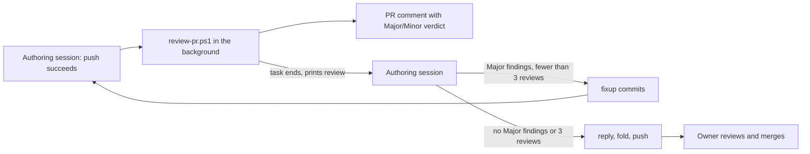

# The authoring session follows the PR review

## Status

Accepted. Amends [ADR 0010](0010-local-claude-review-of-every-pull-request.md): the authoring session, not a hook, starts the review, and it follows the review before the owner is asked. The review stays advisory and independent.

## Context

[ADR 0010](0010-local-claude-review-of-every-pull-request.md) had a `PostToolUse` hook start `review-pr.ps1` in the background after `gh pr create` or `git push`, and told the authoring session not to wait. The session never learned the review had arrived, so the owner was asked to review before the findings were dealt with ([MAY-84: Need: The automatic code review comments are addressed before agent asks me to review.](https://linear.app/mayday-robot/issue/MAY-84)). A check on 2026-11-03 also showed the hook fires when a background command starts: for a background push it reads the pull request before the new head lands. The hook's plain output never reached the agent. The design and those checks are in [the MAY-84 design](../designs/may-84-review-loop.md).

## Decision

- The authoring session runs `scripts/review-pr.ps1` in the background after `gh pr create` and after each push that succeeds. The background task ending wakes the session, and the script prints the posted review. The `PostToolUse` review hook (`claude-review-hook.ps1`) and its settings entry are removed.
- The reviewer labels every finding Major or Minor and starts the review with `**Verdict:** <n> Major, <m> Minor`. It reads earlier reviews and replies on the pull request.
- The session fixes every Major finding and cheap, local Minor ones as fixup commits, pushes and runs the review again. It stops at a review with no Major findings or after 3 reviews, replies once on the pull request with what it fixed and declined, folds the fixups, and asks the owner to review. The rules are in `CLAUDE.md`.
- `review-pr.ps1` skips a head commit whose code tree equals that of a commit already reviewed on the same pull request, as after folding fixups, and prints the skip.

## Alternatives Considered

- An instruction in `CLAUDE.md` only, with the hook unchanged: nothing wakes the session when the review lands, and the hook reviews the old commit on a background push.
- The desktop app's pull request monitor as the wake signal: unverified for comments posted under the pull request author's own login, and it needs approval for each pull request.
- A wait script with locks and marker files ([LasseBoerresen/Mayday#57](https://github.com/LasseBoerresen/Mayday/pull/57)): 17 review rounds without converging, as each fix exposed a new race in the machinery itself.
- A script that parses the verdict and decides the next step: testable, but more than the issue needs; the session reads the verdict.

## Why

A background task that ends is the one wake signal that works today, and the review script, already tested, does the waiting. Severity decided by the reviewer keeps the review independent, and the cap of 3 bounds the cost when reviews keep finding Minor issues.

## Consequences

- Benefits: the owner is asked to review after the automatic findings are fixed or answered; no new wait machinery.
- Costs: up to 3 reviews per pull request on the owner's Claude login, plus one for a fold that changes the code (cheap Minor fixes after the last review, or a rebase onto a moved `master`); that last review is reported to the owner, not followed up.
- Limitations: whether the session follows `CLAUDE.md`, and how well the reviewer grades severity, are exercised by use, not by tests. Pushes from a terminal or IDE are no longer reviewed automatically; run `scripts/review-pr.ps1` by hand. The review dies if the session ends first.

## Related Components

[scripts](../../scripts/README.md), [repository root](../../README.md)

## Related ADRs

[0010](0010-local-claude-review-of-every-pull-request.md), [0012](0012-pr-reviewer-reads-linear.md), [0007](0007-infrastructure-code-is-tested-like-product-code.md)

## Related Findings

[Claude Code background tasks and hooks](../../knowledge/findings/claude-code-background-tasks-and-hooks.md); failed attempt: [wait machinery around a detached PR reviewer](../../knowledge/failed-attempts/review-wait-machinery.md)

## Related Root Causes

None recorded.
