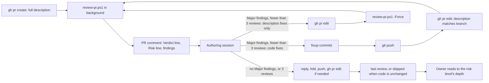

# PR descriptions set a risk level and list test changes

## Status

Accepted. Amends [ADR 0010](0010-local-claude-review-of-every-pull-request.md)'s reviewer prompt, and [ADR 0014](0014-authoring-session-follows-the-review.md)'s review loop and review output.

## Context

The owner approves pull requests from the description, the commits and the review, without reading the code unless the change calls for it. The description was written once at `gh pr create`, so it went stale after review fixes. It gave no risk level to say how much to read, had no reading order, and did not single out test changes, although tests are the specification the owner steers. The reviewer's Major definition covered only "a behavior change without a test", so deleting or weakening a test could be graded Minor and declined. The problem, the options and the reviews are in [the MAY-72 design](../designs/may-72-pr-risk-levels.md) ([MAY-72: Need: Pr descriptions are more concise, hierarchical and has a risk level](https://linear.app/mayday-robot/issue/MAY-72/need-pr-descriptions-are-more-concise-hierarchical-and-has-a-risk)).

## Decision

The rules are in `CLAUDE.md`, Pull requests, which is the authoritative text. In summary:

- The description has a fixed order, and each part is a reading depth:
  - L0, a top block of at most 5 source lines: `Fixes` or `Part of` the issue, `**Risk:** <level> (<criteria matched>)`, and the outcome.
  - L1: `## Test changes`, listing every test added, changed, quarantined, skipped or removed, with the reason; and `## Verification`, saying what ran and what was not run.
  - L2: a collapsed Details block, together with the commit bodies.
  - L3: the diff.
- The risk level is the highest level whose criterion the PR matches. It sets how deep the owner reads:
  - Critical, L0 to L3: weakens a test of behavior that stays, or loosens a motion limit, a guard or a rule.
  - High, L0 to L2: changes a need, an assumption, the architecture, a reference, a data format or a rule, changes a test's expectation, or removes tests along with their behavior.
  - Medium, L0 and L1: any other code change.
  - Low, L0: documentation, chore, or a refactoring with the tests untouched.
- `CLAUDE.md` defines weakening a test. A Critical PR is coherent and holds nothing unrelated. Approving a PR whose Test changes section lists a changed expectation and its reason counts as the owner's confirmation that the contract changed.
- The authoring session updates the description with `gh pr edit --body-file` after each push and before the review that push starts. After a round whose only fixes are to the description, it runs `review-pr.ps1 -Force`, which counts toward the cap of 3 reviews.
- The reviewer reads the description with `gh pr view` and checks it against `CLAUDE.md`:
  - Major: a weakened test with no reason given, a test change the description does not list, a risk level that is understated or missing, or unrelated work in a Critical PR.
  - Minor: a risk level that is overstated, a top block that is too long, or sections out of order.
- The second line of the review is `**Risk:** <level> (agrees | understated | overstated | missing)`, the reviewer's own grade.

This ADR does not cover the commit body's Verification field. That field is a body-field convention in `CLAUDE.md`, Commits, like Problem, Rationale and Impact.

## Alternatives Considered

- **The reviewer sets the level.** The level would then live in a comment that the last review does not follow up.
- **The author sets the level, unchecked.** An understated level would hide what needed reading.
- **Three levels.** Changing the architecture would then force a full read of the code.
- **"Touches code that moves hardware" as Critical.** Almost every change here does, so the criterion would carry no signal.
- **A Critical PR holds only the critical change.** The owner would lose the context needed to judge it.
- **A GitHub PR template.** The scale is made of rules, so it needs `CLAUDE.md` anyway.
- **A separate rules document.** It depends on the session following a link.
- **A total line limit on the description.** It would cut the test list.
- **Rewrite the description once, after the reviews.** The final description would never be checked.
- **Report a risk mismatch only as a finding.** An agreement would not be visible.
- **Machine detection of weakened tests.** This means reading C# by pattern, and the bypasses have a long tail.
- **A script that drafts the test list.** It sees test names, not the reasons.
- **Re-review keyed on a hash of the description.** It adds the marker-file state that failed before.
- **List the commits in the description.** The Commits tab already shows the folded commits.
- **No re-review after description-only fixes.** The stopping rule of ADR 0014 would need a new exit.

## Why

The owner's attention goes where the risk is. The level is set before reading and is checked independently, by the reviewer rather than by the author, as ADR 0010 intends. Listing test changes by name makes changes to the specification visible without reading the diff. Keeping the rules once in `CLAUDE.md`, and having the prompt cite them, avoids two copies that drift apart.

## Consequences

- **Benefits:**
  - The owner reads Low and Medium PRs from the top block and the sections.
  - A test that is removed or weakened without a reason is a Major finding.
  - The description the owner approves is the one the last review saw, apart from edits that apply that review's findings.
- **Costs:**
  - Keeping the description current is bookkeeping for the authoring session.
  - Description findings and forced re-reviews use rounds of the cap of 3.
  - The reviewer prompt is longer.
- **Limitations:**
  - Whether sessions keep the description current, and how well the reviewer grades, are exercised by use, not by tests.
  - The risk criteria are judged, not computed.
  - A reason written in the description clears the weakened-test Major. The PR is still Critical, so the owner reads the reason and the code.
  - The reviewer reads the `CLAUDE.md` of the PR's head, so a PR that edits Pull requests is graded by its own text. Loosening that text matches Critical on the scale before the edit.

## Related Components

[scripts](../../scripts/README.md), [repository root](../../README.md)

## Related ADRs

[0007](0007-infrastructure-code-is-tested-like-product-code.md), [0010](0010-local-claude-review-of-every-pull-request.md), [0011](0011-pre-push-gate-drives-the-robot.md), [0012](0012-pr-reviewer-reads-linear.md), [0014](0014-authoring-session-follows-the-review.md)

## Related Findings

- Lesson: [a ratchet that reads C# by pattern has a long tail of bypasses](../../knowledge/lessons-learned/ratchet-by-pattern-reading-has-a-long-tail.md).
- Lesson: [make tests able to fail on the bug they guard](../../knowledge/lessons-learned/tests-must-discriminate.md).
- Failed attempt: [wait machinery around a detached PR reviewer](../../knowledge/failed-attempts/review-wait-machinery.md).

## Related Root Causes

None recorded.
