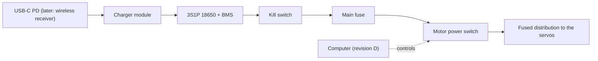

# A Li-ion battery, charged on board

## Status

Accepted. Planned for hardware revision C; nothing is built yet.

## Context

Mayday is meant to behave like a house cat: always on, finding its own charging nest. It runs from a 12 V 5 A supply on a tether today. 18 XL430-W250 servos can draw about 25 A at stall (1.4 A each at 12 V) and about 0.94 A at standby (52 mA each), even with torque off. The owner wants USB-C charging first and wireless charging later; solar is dropped. A walk of 10 minutes on one charge is enough.

## Decision

- Battery: 3S1P high-drain 18650 Li-ion cells (for example Molicel P28A, ~31 Wh, ~140 g, 35 A rated) with a balancing BMS that allows at least 25 A peaks. The capacity is confirmed by the average draw measured in revision B.
- Charging on board, from a bought module: USB-C PD input, the robot stays on while charging, and the charge ends at 4.1 V per cell (12.3 V) where the module allows it. A later wireless receiver feeds the same input.
- The computer can switch the motor bus off after the robot lies down, so standby draw does not eat the charge. A manual kill switch cuts everything.
- The motors draw from the battery side, not through the charger's system output, because charger modules are rated for a few amperes ([candidates](../../knowledge/findings/onboard-charger-and-bms-candidates.md)).

## Diagram (if helpful)

Planned for revision C; nothing here exists yet.

## Alternatives Considered

- 3S LiPo pouch (~1000 mAh, ~85 g) with an external balance charger: the smallest and lightest option, but pouch cells are the riskier chemistry to charge unsupervised, and an external charger rules out a nest.
- High-drain 21700 cells (~46 Wh, ~210 g): more runtime than 10 minutes needs.
- Designing a charging PCB: no need while modules exist.
- Charging to 4.2 V per cell: ~10 % more capacity, but 12.6 V is above the XL430's rated 12.0 V, and cells age faster.

## Why

Cylindrical Li-ion cells with a BMS are the safer chemistry to charge without supervision, which an always-on robot does. Charging on board is what lets the robot reach its nest on its own. Switching the motor bus off matters because standby draw alone is close to what a wireless pad delivers.

## Consequences

- Benefits: no tether; charging without the owner; the same input serves USB-C and wireless.
- Costs: ~140 g more mass, a BMS and a charger module to fit in the body, and a motor power switch to build.
- Limitations: whether the pack fits the body is still to be checked in Fusion; the 4.1 V termination depends on the chosen module; with the motors off while charging, the robot cannot move on its nest.

## Related Components

[hardware/mayday](../../hardware/mayday/README.md), [Dynamixel](../../Dynamixel/README.md)

## Related ADRs

[0014](0014-fusion-is-the-cad-source-the-repository-holds-exports.md)

## Related Findings

[Onboard charger and BMS candidates](../../knowledge/findings/onboard-charger-and-bms-candidates.md)

## Related Root Causes

None recorded.
