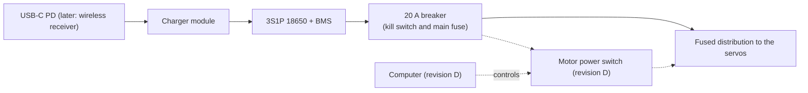

# A Li-ion battery, charged on board

## Status

Accepted. Planned for hardware revision C; nothing is built yet.

## Context

Mayday is meant to behave like a house cat: always on, finding its own charging nest. It runs from a 12 V 5 A supply on a tether today. 18 XL430-W250 servos can draw about 25 A at stall (1.4 A each at 12 V) and about 0.94 A at standby (52 mA each), even with torque off. Their rated operating range is 6.5–12.0 V, and Robotis recommends a 3S Li-ion supply (11.1 V nominal) for them. The owner wants USB-C charging first and wireless charging later; solar is dropped. A walk of 10 minutes on one charge is enough.

## Decision

- Battery: 3S1P high-drain 18650 Li-ion cells (for example Molicel P28A, ~31 Wh, ~140 g, 35 A rated) with a balancing BMS that allows at least 25 A peaks. The capacity is confirmed by the average draw measured in revision B.
- Charging on board, from a bought module: USB-C PD input, the robot stays on while charging, and the charge ends at 4.1 V per cell (12.3 V) where the module allows it. A later wireless receiver feeds the same input.
- The charger connects on the battery side, before the 20 A breaker that is revision B's kill switch and main fuse. The motors draw from the battery through that breaker, not through the charger's system output, because charger modules are rated for a few amperes ([candidates](../../knowledge/findings/onboard-charger-and-bms-candidates.md)).
- In revision C the breaker is also the motor switch: switched off by hand, it leaves the motors unpowered while the battery keeps charging. Switching the motor bus off automatically after the robot lies down, so standby draw does not eat the charge, comes with the onboard computer in revision D.

## Diagram (if helpful)

Planned; nothing here exists yet. The dashed parts are revision D.

## Alternatives Considered

- 3S LiPo pouch (~1000 mAh, ~85 g) with an external balance charger: the smallest and lightest option, but pouch cells are the riskier chemistry to charge unsupervised, and an external charger rules out a nest.
- High-drain 21700 cells (~46 Wh, ~210 g): more runtime than 10 minutes needs.
- Designing a charging PCB: no need while modules exist.
- Charging to 4.2 V per cell (12.6 V): ~10 % more capacity, but the highest voltage at the servos and faster cell ageing.
- Charging to 4.0 V per cell (12.0 V), inside the XL430's rated range: about 10 % less capacity than at 4.1 V.
- A 12 V regulator between pack and servos, keeping the rated range at any charge: a converter for ~25 A peaks adds heat, mass and a part that can fail.
- A motor power switch in revision C, operated by the host PC: the U2D2 has no output to drive it, and anything else would need another cable to the PC.

## Why

Cylindrical Li-ion cells with a BMS are the safer chemistry to charge without supervision, which an always-on robot does. Charging on board is what lets the robot reach its nest on its own.

A full charge at 12.3 V is above the XL430's rated 12.0 V. It stays below the 12.6 V of the 3S Li-ion supply Robotis itself recommends for the XL430, the servos flag an input voltage error only above 14.0 V by default, and under load the pack soon sags below 12.0 V. 4.1 V per cell costs less capacity than 4.0 V and less hardware than a regulator, and lengthens cell life.

Switching the motor bus off matters because standby draw alone is close to what a wireless pad delivers. Until a computer on board can do it, the breaker does it by hand.

## Consequences

- Benefits: no tether for power; charging without the owner; the same input serves USB-C and wireless.
- Costs: ~140 g more mass, and a BMS and a charger module to fit in the body.
- Limitations: right after a full charge the servos see up to 0.3 V above their rated 12.0 V, as with Robotis's own 3S batteries. In revision C, with the breaker on, the servos' ~0.94 A standby draw hides the falling current a charger ends a charge on, so the charge may not end normally; a complete charge needs the breaker off, and then the robot cannot move on its nest. Whether the pack fits the body is still to be checked in Fusion; the 4.1 V termination depends on the chosen module.

## Related Components

[hardware/mayday](../../hardware/mayday/README.md), [Dynamixel](../../Dynamixel/README.md)

## Related ADRs

[0015](0015-fusion-is-the-cad-source-the-repository-holds-exports.md)

## Related Findings

[Onboard charger and BMS candidates](../../knowledge/findings/onboard-charger-and-bms-candidates.md)

## Related Root Causes

None recorded.
