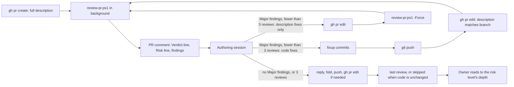

# PR descriptions give a current summary with a risk level and the test changes

*   **Author:** LB
*   **Status:** Proposed
*   **Date:** 2026-11-22, revised 2026-11-23 after two design review rounds
*   **Issue:** [MAY-72: Need: Pr descriptions are more concise, hierarchical and has a risk level](https://linear.app/mayday-robot/issue/MAY-72/need-pr-descriptions-are-more-concise-hierarchical-and-has-a-risk)

## Overview

The owner approves every pull request without reading its code, unless its
risk calls for a full read. The approval rests on three things: the PR
description, the order and subjects of the commits, and the automatic review.
Today the description is written once, when the PR is opened, does not say how
risky the change is, and does not single out changes to tests. Tests are the
specification of the system (CLAUDE.md, Testing: "Tests are a second,
independent ledger of behavior"), so a change to a test is a change to what the
owner has specified.

This design makes the PR description the owner's approval record: a short,
layered summary with a risk level and a list of every test added, changed or
removed. The authoring session updates the description after every push,
before the review that push starts. Each review therefore checks the
description, and the description describes the branch as it will be merged.
The risk level tells the owner how deep to read. The reviewer treats
removing, weakening or skipping a test without a stated reason as a Major
finding. Each commit body also states how its intent was verified.

## The Problem

1.  **The description goes stale.** The authoring session (the Claude Code
    session that writes the change and opens the PR) writes the body at
    `gh pr create`. Review fixes arrive later as fixup commits and are folded
    ([ADR 0014](../adr/0014-authoring-session-follows-the-review.md)), but
    nothing tells the session to update the body. The owner can approve on a
    summary that no longer matches the code.
2.  **There is no risk level.** The owner has no signal for how much of a PR
    to read. PR #69 changed a physical robot test and PR #66 changed one
    README; both bodies read the same way (Problem, Change, Verification).
3.  **Test changes are not visible.** A test whose expectation changed, or a
    test that was deleted, appears only inside the "Change" prose, if at all.
    The owner, who steers the specification through tests, has to read the
    diff to find out.
4.  **Descriptions have no reading order.** The bodies of PRs #66–#70 are 10
    to 25 lines of prose under Problem, Change and Verification headings. The
    owner has to read all of it to find the outcome and what to look at.
5.  **The reviewer does not grade test removals as Major.** The reviewer prompt
    in `scripts/review-pr.ps1` lists "changed expectations in existing tests"
    as something to look for, but its Major definition covers only "a
    behavior change without a test". Deleting a test, weakening an assertion
    (for example a wider tolerance) or removing rows from a theory can be
    graded Minor and declined by the author.
6.  **Commits do not say how they were verified.** The commit body rule in
    CLAUDE.md asks for Problem, Rationale and Impact. How each intent was
    proven (a test made red then green, a run on the echo model that simulates
    Mayday's joints, nothing run) appears only in the PR description, if at
    all, and is lost from `git log` after merge. The owner reads commit bodies
    on High and Critical PRs; on all PRs the field stays in `git log`.

The pre-push quarantine ratchet (`scripts/quarantine-ratchet.ps1`) already
fails a push that skips or quarantines a test that exists on `master`. It does
not see a deleted test or a weakened assertion.

## Goals

*   **G1 – Current summary.** When the authoring session asks the owner to
    review, the PR description describes the branch as it will be merged, and
    the last review saw that description, apart from later edits that apply
    that review's findings.
*   **G2 – Risk level sets reading depth.** Every PR description states one
    risk level from a fixed four-level scale, with the criteria that put it
    there. The level sets how deep the owner reads (depths L0 to L3, §1): Low
    L0 only, Medium L0 and L1, High L0 to L2, Critical L0 to L3, the code
    included.
*   **G3 – Test changes listed.** Every PR description has a section listing
    each test added, changed, quarantined, skipped or removed, by test name,
    with the reason for each. `No tests changed.` is stated when true.
*   **G4 – Concise and layered.** The description leads with the outcome and
    the risk level in at most 5 source lines, then the test changes and what
    was verified, with detail in a collapsed block the owner can skip.
*   **G5 – Reviewer guards tests and the risk level.** The reviewer grades as
    Major any weakened test whose reason is not given in the description, and
    any test change the description does not list. It checks the risk level
    and prints its own grade on a second `**Risk:**` line of its comment (§4).
*   **G6 – Verification per commit.** Every commit body except `chore:` has a
    `Verification:` field after `Impact:` saying how that commit's intent was
    shown to work. After folding, the field describes the folded commit. The
    reviewer grades a missing field Minor, and Major a field that names a test
    that does not exist or does not exercise the change.

## Non-Goals

*   **Blocking merges on risk.** The risk level informs the owner; it does not
    become a status check, a branch rule or a gate step. The review stays
    advisory ([ADR 0010](../adr/0010-local-claude-review-of-every-pull-request.md)).
*   **Detecting weakened assertions by machine.** Deciding by reading C#
    whether an assertion got weaker is pattern-matching that has "a long tail
    of bypasses"
    ([lesson: a ratchet that reads C# by pattern](../../knowledge/lessons-learned/ratchet-by-pattern-reading-has-a-long-tail.md)).
    The reviewer judges this, and the ratchet is not extended.
*   **Changing the review loop's limits.** The cap of 3 reviews and the
    fixup/fold flow of ADR 0014 stay as they are. The reviewer's grading and
    output gain new checks and a second line (§4); a new ADR 0015 records that
    change to ADR 0014's contract.
*   **Rewriting PRs written by hand.** PRs written by hand from a terminal or
    IDE are reviewed only when someone runs `review-pr.ps1` by hand. Nothing
    rewrites their description; the reviewer checks them the same way, and its
    findings stay advisory.
*   **Commit subject format.** The `<type>: <imperative summary>` subject rule
    and the Problem, Rationale and Impact fields are unchanged; only a
    Verification field is added (G6).
*   **Branch-wide claims in a commit.** A commit's Verification field does not
    claim the gate passed on that commit: the gate runs on the working tree or
    the push, not per commit. The PR description reports the gate run.

## Decisions

Decided with the owner on 2026-11-22 and 2026-11-23. The resulting rules are
in the Technical Plan.

*   **Who sets the risk level:** the authoring session sets it and names the
    criteria it matched. The reviewer checks it against the fixed criteria,
    prints its own grade, and reports an understated level as Major. The
    author alone was rejected because a session grading its own work has the
    blind spots ADR 0010 brings in a separate reviewer to avoid. The reviewer
    alone was rejected because the level would then live in a review comment;
    see Alternative A.
*   **Scale:** four levels, one per reading depth (§1). Touching code that
    moves hardware is not by itself a criterion, because almost every change
    in this project does.
*   **Removing a test with the behavior it covers:** High, not Critical.
    Critical is kept for a weakened test of behavior that stays.
*   **Where the rules live:** CLAUDE.md holds the rules once: a Pull requests
    section, and Verification in Commits. Its text (Detailed Implementation
    Plan, file 3) is authoritative; §1 and §2 summarise it. The reviewer prompt
    cites CLAUDE.md and lists only the checks and their grades. Pester pins the
    prompt. ADR 0015 records the description and reviewer decision; the
    Verification field is a body-field convention like Problem, Rationale and
    Impact and has no ADR.
*   **Concise:** a fixed order with a 5-line budget on the top block only.
*   **Commits in the description:** none. The owner reads the commit order and
    subjects in the PR's Commits tab, which shows the folded commits.
*   **When the description is updated:** after every push, before the review
    it starts, and with a forced re-review after a round whose only fixes are
    to the description (§3).

## Critical User Journeys (CUJs)

The top block of every description has a line
`**Risk:** <level> (<criteria matched>)` (§1), and every review comment has a
second line `**Risk:** <level> (agrees | understated | overstated | missing)`
with the reviewer's own grade (§4).

### CUJ 1: Owner approves a Low PR from the top block

*   **Given**: A PR that only changes documentation, the reviews have ended,
    and the fixups are folded.
*   **When**: The authoring session asks the owner to review.
*   **Then**: The top block gives the outcome and
    `**Risk:** Low (documentation only)`, and the reviewer's Risk line says
    `agrees`. The owner reads the top block and the Commits tab and approves
    without opening the diff.

### CUJ 2: Owner reads a Medium PR to L1

*   **Given**: A PR that changes planner behavior and adds a test for it.
*   **When**: The owner opens the PR.
*   **Then**: The top block states Medium ("changes behavior"). The owner
    reads the Test changes and Verification sections, which name the added
    test, and not the details or the code.

### CUJ 3: Owner reads a High PR to L2

*   **Given**: A PR that adds a project reference and records it in an ADR.
*   **When**: The owner opens the PR.
*   **Then**: The top block states High ("adds a project reference"). The
    owner reads the sections, the details and the commit bodies, and not the
    code.

### CUJ 4: Owner reads all of a Critical PR

*   **Given**: A PR that loosens a joint limit, together with the planner
    change and the test update that the new limit needs.
*   **When**: The owner opens the PR.
*   **Then**: The top block states Critical ("loosens a joint limit"). The
    related changes are in the same PR, so the owner reads the whole change,
    text and code, in one place. Had it also carried an unrelated
    refactoring, the reviewer would have reported a Major finding asking for
    that to move to its own PR.

### CUJ 5: Owner steers a test change

*   **Given**: A PR that changes the expected value of an existing test and
    adds a new test.
*   **When**: The owner reads the description.
*   **Then**: The PR is High ("changes an existing test's expectation"). The
    Test changes section names both tests, says which one changed and from
    what to what, and gives the reason. The owner can accept or reject the
    specification change without reading the diff.

### CUJ 6: A description-only fix is re-reviewed

*   **Given**: A PR that widens a test's tolerance, and a review that reports a
    Major finding because the description gives no reason.
*   **When**: The authoring session adds the reason with `gh pr edit` and
    changes no code.
*   **Then**: The session runs `review-pr.ps1 -Force`, which counts as one of
    the 3 reviews. That review sees the reason and does not report the
    finding again.

### CUJ 7: Description stays current through review fixes

*   **Given**: A PR whose review rounds added fixup commits that change a test.
*   **When**: The session makes each fix.
*   **Then**: After each push and before the review it starts, the session
    updates the description, so every review checks the current Test changes
    section and risk level. A fold that leaves the PR's changes as they were
    needs no description change. The owner gets a description the last review
    saw, apart from edits that apply that review's findings.

### CUJ 8: Owner sees how each commit was verified

*   **Given**: A folded branch with a `test:` commit, a `refactor:` commit and
    a `docs:` commit.
*   **When**: The owner runs `git log origin/master..HEAD`, or reads the
    commit bodies of a High PR.
*   **Then**: Each body ends its fields with `Verification:`. The `test:`
    commit names the new test and how it was shown able to fail; the
    `refactor:` commit names the existing tests that prove behavior was
    preserved; the `docs:` commit says `Not run: documentation only.`

## Technical Plan (Architecture)

The change is a set of written rules for two sessions that already exist:
the authoring session, which follows `CLAUDE.md`, and the reviewer, a separate
headless session started by `scripts/review-pr.ps1` that follows that
script's prompt. No new script, hook or machine check is added; the gate and
the quarantine ratchet are unchanged.

### §1. The PR description contract (`CLAUDE.md`, Pull requests)

This section summarises the rule text in `CLAUDE.md`, Pull requests (Detailed
Implementation Plan, file 3). That text is authoritative.

Each layer of the description is a reading depth:

| Depth | Part | Content |
|---|---|---|
| L0 | Top block, at most 5 source lines | `Fixes <issue link>` (or `Part of <issue link>` when the PR does not finish the issue); `**Risk:** <level> (<criteria matched>)`; one sentence on the outcome. |
| L1 | `## Test changes` | One line per test added, changed, quarantined, skipped or removed: its name, what changed in plain words (for example "tolerance 1 mm to 2 mm"), and why. `No tests changed.` when none. |
| L1 | `## Verification` | What ran (the gate in Debug, manual runs, behavior observed on the robot or the echo model) and what was not run. |
| L2 | `<details><summary>Details</summary>` | Problem, rationale, knowledge relied on. Commit bodies are also L2. |
| L3 | The diff | The code. |

The commit order and subjects are read in GitHub's Commits tab, not repeated
in the description.

**Risk levels.** The level is the highest one whose criterion the PR matches.
The author names the matched criteria in the top block.

| Level | Owner reads | Criteria |
|---|---|---|
| Critical | L0 to L3 | Weakens a test of behavior that stays; loosens a joint, velocity or motion limit (removing a clamp included); loosens the gate, a hook, the quarantine ratchet, the reviewer prompt or its tools, the clear-to-move handling, or the permissions in `.claude/settings.json`; loosens a rule in `CLAUDE.md` or an accepted ADR. |
| High | L0 to L2 | Changes a need (an issue's stated outcome) or a main assumption (one the design rests on, such as how a robot is driven or what a test tier means); changes the architecture (dependency direction, project boundaries, `RobotDomain` root types); adds a project reference or package; changes a persisted data format; adds or changes a rule in `CLAUDE.md` or an ADR without loosening one; changes an existing test's expectation without weakening it; removes tests together with the production behavior they cover. |
| Medium | L0 and L1 | Changes behavior; adds tests; renames or moves a test without changing what it asserts; any other code change. |
| Low | L0 | Documentation only, only `chore:` commits, or a refactoring that leaves every test untouched. |

The gate and its hooks are those of `CLAUDE.md`, Local gate. The clear-to-move
handling is the operator's `MAYDAY_ROBOT_IS_CLEAR_TO_MOVE` confirmation that
the pre-push gate reads
([ADR 0011](../adr/0011-pre-push-gate-drives-the-robot.md)).

**Weakening a test** means: after the change, the test passes in more cases,
runs less often, or no longer runs. Examples: deleting a test method, file or
theory row; removing `[Fact]`; widening a tolerance; replacing an assertion
with a weaker one (`NotNull` for `Equal`); adding `[Quarantine]` or `Skip`;
moving a test to a tier or project that runs less often (`Tier=Manual`, a
project outside the gate); weakening a shared test helper. "Test" covers
every test the gate runs, plus `Ellie\EllieMainTests`. A new test that
arrives with `[Quarantine]` and a `MAY-` issue, as `Test/CLAUDE.md` allows,
counts as added, not weakened.

**A Critical PR is coherent and holds nothing unrelated.** It holds the
critical change and every change that belongs with it (the code it enables or
requires, its tests, docs and ADR), so the owner reads the whole change in
one place. Unrelated work (a drive-by refactoring, formatting, a second task)
goes to its own PR, as the `CLAUDE.md` Focus rule already says. Related
changes are not split out to make the PR smaller.

### §2. The Verification field (`CLAUDE.md`, Commits)

The body fields become Problem, Rationale, Impact and Verification, for every
type except `chore`. Verification states how this commit's intent was shown
to work, in terms true of the commit, not the branch:

*   behavior change: the test that fails against the old behavior and passes
    with the new;
*   refactoring: the existing tests that prove behavior was preserved;
*   `test:` on existing behavior: the new test, and how it was shown able to
    fail ([lesson: make tests able to fail on the bug they guard](../../knowledge/lessons-learned/tests-must-discriminate.md));
*   documentation: `Not run: documentation only.`

When a fix makes a commit's Verification untrue or incomplete, the author
commits the fix as `amend!` with the updated Verification (CLAUDE.md, Review
fixes).

### §3. When the description is updated (`CLAUDE.md`, Local gate)



*   The authoring session writes the full description at `gh pr create`.
*   When a round fixes code, the session updates the description with
    `gh pr edit --body-file` after the push succeeds and before it runs the
    review that push starts.
*   When a round's only fixes are to the description, no push happens, and
    `review-pr.ps1` would skip the unchanged head. The session runs
    `review-pr.ps1 -Force` instead. It counts toward the cap of 3.
*   A fold that leaves the PR's changes as they were needs no description
    change: the description lists no commits, and `review-pr.ps1` skips the
    fold push when its code tree is unchanged. If the fold changes the PR's
    changes (cheap Minor fixes, or conflicts resolved when rebasing onto a
    moved `master`), the session updates the description after the fold push
    and before its review, which is the last review. Edits that only apply
    the last review's description findings are not reviewed again (G1).

### §4. What the reviewer checks (`scripts/review-pr.ps1` prompt)

The prompt tells the reviewer to read the description with `gh pr view` and
check it against "CLAUDE.md, Pull requests". It does not copy the scale or
the weakening definition. It adds these checks:

| Grade | Check |
|---|---|
| Major | A test weakened (as CLAUDE.md defines it) without a reason in the description. |
| Major | A test added, changed or weakened that the Test changes section does not list, or `No tests changed.` when tests changed. |
| Major | A risk level lower than the highest criterion the diff matches, or no risk level. |
| Major | A Critical PR that also carries changes unrelated to its critical change. The reviewer does not ask for related changes to be split out. |
| Major | A Verification field that names a test that does not exist or does not exercise the change. |
| Minor | A risk level higher than the diff matches, a top block over 5 lines, or sections out of order. |
| Minor | A commit body without a Verification field. |

The review comment keeps its first line as now,
`**Verdict:** <n> Major, <m> Minor`. Its second line is
`**Risk:** <level> (agrees | understated | overstated | missing)`, where
`<level>` is the reviewer's own grade.

## Risks

*   **Adherence is tested only by use.** Pester pins the reviewer prompt's
    wording. It cannot test whether the authoring session updates the
    description or how well the reviewer grades. ADR 0014 records the same
    limitation. The owner reading the top block and the Risk line is the last
    check.
*   **Risk criteria are judged, not computed.** "Changes a need or main
    assumption" and "related" need judgment, and both sessions can agree on a
    wrong grade. The reviewer's Risk line makes a disagreement visible. A
    Critical PR that grows large because much is related is visible in the
    top block and the Commits tab, so the owner can ask for a split.
*   **A PR can edit the scale it is graded by.** The reviewer reads the head's
    `CLAUDE.md`, as it has for every rule since ADR 0010, so a PR that edits
    Pull requests is graded by its edited text. Loosening that text matches
    Critical on the scale before the edit, and the diff shows the edit to the
    reviewer and the owner. Accepted without further mitigation.
*   **Verification is a claim.** The reviewer reads code and does not run it.
    The "Together" rule (CLAUDE.md, Commits) ships a test with its change, so
    no failing commit exists in history. The reviewer can check that the named
    test exists and exercises the change, not that it failed before. When the
    fold push is skipped, the folded field is not reviewed again. Accepted
    without further mitigation.
*   **The author's text lowers severity.** A reason written in the
    description clears the weakened-test Major. A weakened test of behavior
    that stays still makes the PR Critical, so the owner reads the code and
    the reason, and their approval is the confirmation CLAUDE.md (Testing)
    requires for a changed expectation.
*   **Bookkeeping uses up reviews.** Description findings and forced
    re-reviews take rounds that correctness fixes used to have, so more PRs
    may reach the cap of 3 with Major findings open. Description fixes ride
    the same push as code fixes when a round has both. Measure in use: how
    many PRs reach the cap with Major findings open, as named in the
    authoring session's reply.
*   **Longer reviewer prompt.** More checks can dilute attention on
    correctness. The prompt cites CLAUDE.md instead of copying the scale, and
    the new checks come after the existing ones in its order of importance.

## Testing

How each change is tested is in the Detailed Implementation Plan (file 6 and
the Verification Plan): one Pester test per reviewer behavior, three in all,
each run first against the current prompt and shown to fail.

## Alternatives Considered

The alternatives below were weighed with the owner on 2026-11-22 and
2026-11-23, except J, L, M and P, which came from drafting and the reviews.

### Alternative A: The reviewer sets the risk level

*   **Pros**: Independent of the session that wrote the change.
*   **Cons**: The level would live in a review comment, not the description,
    and the author would have to copy it. The last review is reported to the
    owner but not followed up (ADR 0014), so the description could lag the
    comment.
*   **Reason for Rejection**: The reviewer checking the author's level and
    printing its own grade on the `**Risk:**` line gives the same independent
    view, and the description stays the single place the owner reads.

### Alternative B: The author sets the risk level, unchecked

*   **Pros**: Simplest; no reviewer change.
*   **Cons**: The session grades its own work. An understated level reaches
    the owner unchallenged, and the owner then reads less than they should.
*   **Reason for Rejection**: The level decides how much the owner reads, so
    an unchecked understated level hides what needed reading.

### Alternative C: Three risk levels (Low / Medium / Critical)

*   **Pros**: Fewer boundaries to grade.
*   **Cons**: Merges "changes a need or the architecture" with "weakens a
    guard". An architecture change then forces a full code read, or is graded
    Medium to avoid that.
*   **Reason for Rejection**: Four levels give one level per reading depth,
    with a checkable line between High (adds or changes) and Critical
    (loosens or weakens).

### Alternative D: "Touches code that can move hardware" as a Critical criterion

*   **Pros**: Easy to check from the changed paths.
*   **Cons**: Almost every change in this project affects how the robot
    moves, so almost every PR would be Critical and the scale would carry no
    signal.
*   **Reason for Rejection**: Rejected by the owner for that reason. Physical
    risk is covered by "loosens a joint, velocity or motion limit" and by the
    pre-push gate, which runs the physical tests
    ([ADR 0011](../adr/0011-pre-push-gate-drives-the-robot.md)).

### Alternative E: A Critical PR holds only the critical change

*   **Pros**: The smallest possible PR for the owner to read in full.
*   **Cons**: Splits out changes that belong with the critical one, so the
    owner sees the change in pieces and loses the context needed to judge it.
*   **Reason for Rejection**: Rejected by the owner for that reason: a
    Critical PR is coherent, not stripped of related changes.

### Alternative F: A GitHub PR template

*   **Pros**: Also guides PRs opened from the GitHub web UI.
*   **Cons**: Claude sessions pass the body with `gh pr create --body-file`,
    so they would have to be told to use the template anyway.
*   **Reason for Rejection**: The risk scale and the weakening definition are
    rules, not layout, so they need `CLAUDE.md` in any case; a template would
    be a second copy of the layout.

### Alternative G: A separate rules document linked from CLAUDE.md

*   **Pros**: Keeps `CLAUDE.md` shorter.
*   **Cons**: Depends on the session following the link.
*   **Reason for Rejection**: `CLAUDE.md` loads in every session, and the
    issue names it as the target.

### Alternative H: A total line limit on the description

*   **Pros**: Easy to check.
*   **Cons**: Forces cutting the test list on a large PR, the part the owner
    needs.
*   **Reason for Rejection**: A budget on the top block alone keeps the first
    read short and the test list complete. A rule on structure alone, with no
    budget, was rejected too: length would drift back to today's 10 to 25
    lines of prose.

### Alternative I: Rewrite the description once, after reviews end

*   **Pros**: Fewer `gh pr edit` calls.
*   **Cons**: After folding, an unchanged code tree skips the review, so the
    final description, its risk level and its test list are never checked.
*   **Reason for Rejection**: The reviewer checks only what the description
    says when it runs; keeping it current before every review lets each
    review check it.

### Alternative J: Report a risk mismatch only as a finding

*   **Pros**: The review comment format stays as it is.
*   **Cons**: When the reviewer agrees with the author's level, nothing in
    the comment shows that it checked.
*   **Reason for Rejection**: A second `**Risk:**` line shows the independent
    grade at a glance and leaves the first line unchanged.

### Alternative K: Detect deleted tests and weakened assertions by machine

*   **Pros**: Does not depend on the reviewer's judgment.
*   **Cons**: Deciding whether an assertion got weaker means reading C# by
    pattern, which the lesson warns against. Listing tests with
    `dotnet test --list-tests` on both trees, the lesson's untried
    suggestion, finds removed names but not weakened assertions, and a gate
    on it would fail removals the owner approved.
*   **Reason for Rejection**: The reviewer already reads the diff, and the
    owner sees each removal in the Test changes section. A non-gating listing
    diff is a Future Improvement if reviews miss removals.

### Alternative L: A script that drafts the Test changes section

*   **Pros**: Removes the most mechanical bookkeeping from the author.
*   **Cons**: A new script with its own tests, against "no new script"; it
    sees names, not the reasons the owner needs.
*   **Reason for Rejection**: The author writes the reasons anyway, and the
    reviewer checks the list.

### Alternative M: Re-review when the description changes, keyed on a body hash

*   **Pros**: Automatic; no `-Force` rule for the session to follow.
*   **Cons**: Adds state and control flow to `review-pr.ps1`, repeats the
    marker-file pattern of the failed wait machinery
    ([failed attempt](../../knowledge/failed-attempts/review-wait-machinery.md)),
    and would start a review on every `gh pr edit`.
*   **Reason for Rejection**: One sentence in the review loop, using the
    existing and tested `-Force`, closes the same gap.

### Alternative N: List the commits in the description

*   **Pros**: Everything the owner reads is in one place.
*   **Cons**: A copy of `git log` that has to be written in folded form to
    stay correct after folding, plus a reviewer check for it.
*   **Reason for Rejection**: Rejected by the owner: the Commits tab shows the
    folded commits.

### Alternative O: Move commit Verification to a separate issue

*   **Pros**: Keeps MAY-72 to PR descriptions.
*   **Cons**: The owner approves from the commits as well as the description.
*   **Reason for Rejection**: The owner chose to keep it in MAY-72.

### Alternative P: No re-review after description-only fixes

*   **Pros**: Saves a review; the session lists the description fixes in its
    final PR reply instead.
*   **Cons**: A round whose only Major findings concern the description would
    never reach a review with no Major findings, so ADR 0014's stopping rule
    would need a new exit, and the last comment's Risk line could still say
    `understated` after the fix.
*   **Reason for Rejection**: The owner chose the forced re-review: it keeps
    ADR 0014's stopping rule as it is.

## Non-Functional Requirements

*   **Cost:** the reviewer prompt grows by about 10 lines, since it cites
    CLAUDE.md instead of copying the scale. A forced re-review costs one of
    the 3 reviews (see Risks).
*   **Security:** no new tool for the reviewer; it already may run
    `gh pr view`.
*   **Rollback:** revert the commits, newest first, since commits 2 and 3 edit
    the same files; no data, state or hook changes.

## Additional Resources

*   [ADR 0010](../adr/0010-local-claude-review-of-every-pull-request.md),
    [ADR 0011](../adr/0011-pre-push-gate-drives-the-robot.md),
    [ADR 0012](../adr/0012-pr-reviewer-reads-linear.md),
    [ADR 0014](../adr/0014-authoring-session-follows-the-review.md)
*   [MAY-84 design: the review loop](may-84-review-loop.md)
*   [Lesson: a ratchet that reads C# by pattern has a long tail of bypasses](../../knowledge/lessons-learned/ratchet-by-pattern-reading-has-a-long-tail.md)
*   [Lesson: make tests able to fail on the bug they guard](../../knowledge/lessons-learned/tests-must-discriminate.md)
*   [Failed attempt: wait machinery around a detached PR reviewer](../../knowledge/failed-attempts/review-wait-machinery.md)
*   `scripts/review-pr.ps1`, `scripts/Tests/ClaudeReview.Tests.ps1`,
    `scripts/quarantine-ratchet.ps1`, `Test/CLAUDE.md`
*   PR bodies of #66–#70, measured 2026-11-22: 10 to 25 lines, no risk level.

## Future Improvements

*   **Listing diff for removed tests.** If reviews miss test removals in use,
    a non-gating step lists tests with `dotnet test --list-tests` on `master`
    and on the head and prints removed names for the reviewer (Alternative K).

## Detailed Implementation Plan

Work outside-in: each reviewer behavior starts as a Pester test that fails
against the current prompt. The `CLAUDE.md` rules ship in the same commit as
the reviewer check for them.

**Branch.** Commit 1 already exists on `claude/egm-draft-may-72-1ae546`.
Implement on that branch. Fixes to this design are fixups of commit 1.

### Commit order

1.  `docs: add the MAY-72 design for PR risk levels and test changes`
    (exists): files 1 and 2.
2.  `feat: state how each intent was verified in commit bodies`: the
    Verification parts of files 3, 5, 6 and 8. Its Verification field names
    `GivenOpenPullRequest_WhenRun_ThenPromptChecksEachCommitBodyForVerification`,
    which failed against the old prompt and passes. In the same push, commit
    an `amend!` of commit 1 that adds a Verification field to its body:

    ```powershell
    git commit --allow-empty -m "amend! docs: add the MAY-72 design for PR risk levels and test changes" -m "<the full message of commit 1, with 'Verification: Not run: documentation only.' as its own field after Impact: and before the trailer>"
    ```

3.  `feat: set a PR risk level that the reviewer checks`: the rest of files
    3, 5, 6 and 8, files 4, 7, 9, 10 and 11, and the status updates of files
    1 and 2. Its Verification field names the two new Pester tests of commit
    3, which failed against the old prompt and pass.

After the work, the authoring session proposes a task summary to the owner
with the `record-knowledge` skill; if approved, it is a fourth, `docs:`
commit.

### Rules for text inside the reviewer prompt

The prompt in `scripts/review-pr.ps1` is a double-quoted PowerShell
here-string (`@" ... "@`), hard-wrapped at 118 columns. Text added to it:

*   is ASCII only (no arrows, en or em dashes or other non-ASCII characters),
    because Windows PowerShell 5.1 reads the BOM-less script as ANSI;
*   has no backticks, because a backtick is PowerShell's escape character
    (a backtick before `f` gives a form feed, before `a` a bell); the
    backticks already around `gh pr diff $($pr.number)` are harmless and stay;
*   has no bare `$`; the PR number is written `$($pr.number)`, as in the
    existing `gh pr view $($pr.number) --comments`;
*   keeps each phrase a test matches on one line, so that re-wrapping cannot
    break a pattern. The texts below are given as exact, wrapped lines.

### Rules for text inserted into Markdown files

`CLAUDE.md` and the READMEs write each paragraph and list item on one line.
The fenced texts below are wrapped for this document: join the lines of each
paragraph and list item when inserting them, except in the commit example,
which keeps its wrapping. Links in the fenced texts are plain Markdown links.

### Target Files to Create/Modify

#### 1. `docs/designs/may-72-pr-risk-levels.md` (exists)

*   **Type / Scope**: Design document.
*   **Proposed Changes**: Commit 3 sets the Status line to:

    ```markdown
    *   **Status:** Implemented ([ADR 0015](../adr/0015-pr-descriptions-set-a-risk-level.md)).
    ```

#### 2. `docs/designs/README.md` (exists)

*   **Type / Scope**: Index.
*   **Proposed Changes**: Commit 3 sets the MAY-72 row's status cell to
    `Implemented (ADR 0015)`, as the MAY-84 row has it.

#### 3. `CLAUDE.md` (Modify)

*   **Type / Scope**: Authoring session rules. The texts below are the
    authoritative rules; §1 and §2 summarise them.
*   **Commit 2, Commits section:** replace the sentence that starts "Body, for
    every type except `chore`" with:

    ```markdown
    Body, for every type except `chore`: `Problem:`, `Rationale:` (why this
    approach over the obvious alternative), `Impact:` (say "No behavioral
    change." when true), `Verification:` (how this commit's intent was shown
    to work, true of this commit and not of the branch: for a behavior change,
    the test that fails against the old behavior and passes with the new; for
    a refactoring, the existing tests that prove behavior was preserved; for a
    `test:` commit on existing behavior, the new test and how it was shown
    able to fail; for documentation, "Not run: documentation only."). Separate
    fields with a blank line and add the attribution trailer last.
    ```

    In the **Review fixes** item, insert before "When a fix outgrows the
    corrected commit's message":

    ```markdown
    A fix that makes the corrected commit's `Verification:` untrue or incomplete outgrows its message.
    ```

    In the `Q.Rotate` example, after `Impact: No behavioral change.`, add a
    blank line and:

    ```text
    Verification: The existing Q.Rotate tests pass unchanged; only XML docs
    changed.
    ```

*   **Commit 3, new `## Pull requests` section** before `## Commits`:

    ```markdown
    ## Pull requests

    The user approves a pull request from its description, the Commits tab
    and the review, and reads as deep as the risk level says. Write the full
    description at `gh pr create`: write the body to a file without a BOM (in
    Windows PowerShell, `[IO.File]::WriteAllText($path, $text, [Text.UTF8Encoding]::new($false))`)
    and pass it with `--body-file`. Its parts, in this order:

    1. Top block, at most 5 source lines: `Fixes <issue link>` (or
       `Part of <issue link>` when the PR does not finish the issue), then
       `**Risk:** <level> (<criteria matched>)`, then the outcome in one
       sentence. The user reads it at every level.
    2. `## Test changes`: one line per test added, changed, quarantined,
       skipped or removed: its name, what changed in plain words and why; or
       `No tests changed.` The user reads it from Medium up.
    3. `## Verification`: what ran (the gate in Debug, manual runs, behavior
       observed on the robot or the echo model) and what was not run. The
       user reads it from Medium up.
    4. `<details><summary>Details</summary>`: problem, rationale, knowledge
       relied on. The user reads it, with the commit bodies, from High up.

    Do not list the commits. The risk level is the highest one whose
    criterion the PR matches; name the matched criteria:

    - **Critical** (the user reads everything, including the code): weakens
      a test of behavior that stays; loosens a joint, velocity or motion
      limit (removing a clamp included); loosens the gate, a hook, the
      quarantine ratchet, the reviewer prompt or its tools, the clear-to-move
      handling, or the permissions in `.claude/settings.json`; loosens a rule
      in `CLAUDE.md` or an accepted ADR. A Critical PR holds the critical
      change and what belongs with it, and nothing unrelated.
    - **High** (the user reads to the details and commit bodies): changes a
      need (an issue's stated outcome) or a main assumption (one the design
      rests on, such as how a robot is driven or what a test tier means);
      changes the architecture (dependency direction, project boundaries,
      `RobotDomain` root types); adds a project reference or package; changes
      a persisted data format; adds or changes a rule in `CLAUDE.md` or an ADR
      without loosening one; changes an existing test's expectation without
      weakening it; removes tests together with the production behavior they
      cover.
    - **Medium** (the user reads the top block and the sections): changes
      behavior, adds tests, renames or moves a test without changing what it
      asserts, or any other code change.
    - **Low** (the user reads the top block): documentation only, only
      `chore:` commits, or a refactoring that leaves every test untouched.

    A test is weakened when, after the change, it passes in more cases, runs
    less often or no longer runs: a test method, file or theory row deleted;
    `[Fact]` removed; a tolerance widened; an assertion replaced by a weaker
    one (`NotNull` for `Equal`); `[Quarantine]` or `Skip` added; the test
    moved to a tier or project that runs less often (`Tier=Manual`, a project
    outside the gate); a shared test helper weakened. Tests are every test the
    gate runs, plus `Ellie\EllieMainTests`. A new test that arrives with
    `[Quarantine]` and a `MAY-` issue counts as added, not weakened.
    ```

*   **Commit 3, review loop** (the bullets under "Local gate"):
    *   In the bullet that starts "While a review has Major findings", after
        "push and run the review again.", insert:

        ```markdown
        After that push succeeds and before running the review, update the description with `gh pr edit --body-file`. When a round's only fixes are to the description, run `scripts\review-pr.ps1 -Force` instead of pushing; it counts toward the 3 reviews.
        ```

    *   In the bullet that starts "Stop after a review", after "fold the
        fixups and push.", insert:

        ```markdown
        Then update the description with `gh pr edit --body-file` if the fold or that review's findings change what it says.
        ```

*   **Rationale**: `CLAUDE.md` loads in every authoring session and is where
    the issue puts the rule.

#### 4. `docs/adr/0015-pr-descriptions-set-a-risk-level.md` (Create, commit 3)

*   **Type / Scope**: ADR, following `templates/adr-template.md`.
*   **Proposed Changes**: Title "PR descriptions set a risk level and list
    test changes". Sections:
    *   **Status:** Accepted. Amends ADR 0010's reviewer prompt and ADR
        0014's review loop and review output.
    *   **Context:** Problems 1 to 5 of this design, summarised in a few
        sentences, with a link to this design.
    *   **Decision:** the `## Pull requests` text of file 3 (summarised, with
        a pointer to `CLAUDE.md` as the authoritative text), §3, and §4
        except its Verification rows. It does not cover the Verification
        field.
    *   **Diagram:** the flowchart of §3.
    *   **Alternatives Considered:** A to N and P, one line each.
    *   **Why:** the owner's reading depth follows the risk level, and the
        reviewer, not the author, is the independent check on it.
    *   **Consequences:** the Risks section, without "Verification is a
        claim".
    *   **Related Components:** scripts, repository root.
    *   **Related ADRs:** 0007, 0010, 0011, 0012, 0014.
    *   **Related Findings:** the lesson "a ratchet that reads C# by pattern
        has a long tail of bypasses", the lesson "make tests able to fail on
        the bug they guard", and the failed attempt "wait machinery around a
        detached PR reviewer", each linked.
    *   **Related Root Causes:** none recorded.

#### 5. `scripts/review-pr.ps1` (Modify)

*   **Type / Scope**: Reviewer prompt and help; text only, no control flow
    changes. Follow the rules for prompt text above.
*   **Commit 2, `Commits:` bullet:** replace its three lines with:

    ```text
    - Commits: one intent per commit, subject format, Problem/Rationale/Impact/Verification bodies.
      A missing Verification field is Minor.
      A Verification field that names a test that does not exist or does not exercise the change is Major. Unfolded
      fixup! and amend! commits are how review fixes are meant to arrive (CLAUDE.md, Review fixes): check what they
      change like any other diff, but do not report their subject or body format; at most note once that they must be
      folded before merge.
    ```

*   **Commit 2, help:** in `.DESCRIPTION`, before "See ADR 0010.", add "The
    prompt also has the reviewer check each commit body's Verification
    field." Re-wrap the paragraph to its current width.
*   **Commit 3, description checks:** after the "Look for, in order of
    importance" list (which ends with the `Commits:` bullet) and before the
    Linear paragraph, insert, followed by a blank line:

    ```text
    Read the PR description with gh pr view $($pr.number) and check it against CLAUDE.md, Pull requests:
    - Major: a test weakened, as CLAUDE.md defines it, without a reason in the description.
    - Major: a test added, changed or weakened that the Test changes section does not list,
      or "No tests changed." when tests changed.
    - Major: a risk level lower than the highest criterion the diff matches, or no risk level.
    - Major: a Critical PR that also carries changes unrelated to its critical change. Do
      not ask for related changes to be split out.
    - Minor: a risk level higher than the diff matches, a top block over 5 lines, or
      sections out of order.
    ```

*   **Commit 3, grading paragraph:** so that "anything else" does not read as
    overriding the grades above, replace the line

    ```text
    - Minor: anything else, such as a rare sequence of commands, wording or a nice-to-have.
    ```

    with

    ```text
    - Minor: anything else not graded above, such as a rare sequence of commands, wording or a nice-to-have.
    ```

*   **Commit 3, output paragraph:** replace its three lines with:

    ```text
    Your final message is posted verbatim as the review comment, so make it only the review in Markdown. Its first line is
    exactly **Verdict:** <n> Major, <m> Minor (with the counts). Its second line is exactly
    **Risk:** <level> (agrees | understated | overstated | missing), where <level> is your own grade of the PR's risk.
    Then come the Major findings, then the Minor ones, each numbered, then what you did not check. Do not post it
    yourself, approve, request changes or merge: the owner decides.
    ```

*   **Commit 3, help:** extend the commit 2 sentence to "The prompt also has
    the reviewer check each commit body's Verification field, and the PR
    description's risk level and test changes against CLAUDE.md, Pull
    requests." and change "See ADR 0010." to "See ADR 0010 and ADR 0015."

#### 6. `scripts/Tests/ClaudeReview.Tests.ps1` (Modify)

*   **Type / Scope**: Pester tests in the existing style, inside
    `Describe 'review-pr.ps1'`: call `Invoke-ReviewPr`, read the prompt with
    `$prompt = Get-Content "$script:Log.prompt" -Raw`, assert with
    `Should -Match`. Each test is run first against the current prompt and
    shown to fail. The patterns are phrases the current prompt does not
    contain. `7` is the fake PR number that `Invoke-ReviewPr` passes.
*   **Commit 2:**
    *   `GivenOpenPullRequest_WhenRun_ThenPromptChecksEachCommitBodyForVerification`:
        matches `Problem/Rationale/Impact/Verification bodies`,
        `missing Verification field is Minor`, and
        `Verification field that names a test that does not exist or does not exercise the change is Major`.
*   **Commit 3:**
    *   `GivenOpenPullRequest_WhenRun_ThenPromptChecksTheDescriptionAgainstClaudeMdPullRequests`:
        matches `description with gh pr view 7\b`,
        `CLAUDE\.md, Pull requests`,
        `Major: a test weakened[^\r\n]*without a reason`,
        `Major: a test added, changed or weakened that the Test changes section does not list`,
        `Major: a risk level lower than[^\r\n]*or no risk level`,
        `Major: a Critical PR that also carries changes unrelated`, and
        `Minor: a risk level higher than[^\r\n]*top block over 5 lines`.
    *   `GivenOpenPullRequest_WhenRun_ThenPromptAsksForARiskLineAfterTheVerdictLine`:
        asserts the order of the two lines:

        ```powershell
        $prompt | Should -Match ([regex]::Escape('**Verdict:** <n> Major, <m> Minor') + '[\s\S]*' + [regex]::Escape('**Risk:** <level> (agrees | understated | overstated | missing)'))
        ```

    *   In the header comment, change `(ADR 0010, ADR 0014)` to
        `(ADR 0010, ADR 0014, ADR 0015)`.
*   The existing `GivenOpenPullRequest_WhenRun_ThenPromptAsksForMajorOrMinorFindingsUnderAVerdictLine`
    test stays unchanged and keeps passing: the Verdict literal it matches
    stays on one line.

#### 7. `docs/adr/0010-local-claude-review-of-every-pull-request.md` and `docs/adr/0014-authoring-session-follows-the-review.md` (Modify, commit 3)

*   **Type / Scope**: ADR status lines; no other text changes.
*   **Proposed Changes**: Append to the end of the Status paragraph of 0010:

    ```markdown
    [ADR 0015](0015-pr-descriptions-set-a-risk-level.md) adds the reviewer's checks of the PR description and a second line to its output.
    ```

    Append to the end of the Status paragraph of 0014:

    ```markdown
    [ADR 0015](0015-pr-descriptions-set-a-risk-level.md) adds new findings, a Risk line and a forced re-review after description-only fixes.
    ```

#### 8. `scripts/README.md` (Modify)

*   **Type / Scope**: Component README, the `review-pr.ps1` entry under
    Public APIs, and Related Records.
*   **Commit 2:** in the `review-pr.ps1` entry, after the sentence that ends
    "and points the reviewer at earlier reviews and replies on the pull
    request.", insert:

    ```markdown
    It checks each commit body's Verification field.
    ```

*   **Commit 3:** after that sentence, insert:

    ```markdown
    It checks the PR description's risk level, test changes and layout against CLAUDE.md, Pull requests, and asks for a second line `**Risk:** <level> (agrees | understated | overstated | missing)` ([ADR 0015](../docs/adr/0015-pr-descriptions-set-a-risk-level.md)).
    ```

    Append `, [ADR 0015](../docs/adr/0015-pr-descriptions-set-a-risk-level.md)`
    to the end of the Related Records list.

#### 9. `docs/adr/README.md` (Modify, commit 3)

*   **Type / Scope**: ADR index.
*   **Proposed Changes**: The 0010 status cell, now "Accepted; review start
    amended by 0014", becomes "Accepted; review start amended by 0014;
    description checks added by 0015". The 0014 status cell, now "Accepted",
    becomes "Accepted; amended by 0015". After the 0014 row, add:

    ```markdown
    | [0015 - PR descriptions set a risk level and list test changes](0015-pr-descriptions-set-a-risk-level.md) | Accepted | Risk level and test changes in PR descriptions, checked by the reviewer; amends 0010 and 0014 |
    ```

#### 10. `knowledge/INDEX.md` (Modify, commit 3)

*   **Type / Scope**: Knowledge index.
*   **Proposed Changes**: Under Most Important Architectural Decisions,
    after the ADR 0014 item, add:

    ```markdown
    - [ADR 0015: PR descriptions set a risk level and list test changes](../docs/adr/0015-pr-descriptions-set-a-risk-level.md) (amends ADR 0010's reviewer prompt and ADR 0014's review loop)
    ```

    In the quality-gate item under Architectural Constraints, after the
    sentence that ends "fixes its Major findings before asking the owner"
    and its ADR 0014 link, insert:

    ```markdown
    PR descriptions state a risk level that sets how deep the owner reads, and list every test change ([ADR 0015](../docs/adr/0015-pr-descriptions-set-a-risk-level.md)).
    ```

#### 11. `README.md` (Modify, commit 3)

*   **Type / Scope**: Repository README, the review paragraph.
*   **Proposed Changes**: At the end of the paragraph that starts "Every
    pull request gets an advisory review", after "It is not a check and
    blocks nothing.", add:

    ```markdown
    Each PR description states a risk level that tells the owner how deep to read, and lists every test change; the review checks both ([ADR 0015](docs/adr/0015-pr-descriptions-set-a-risk-level.md)).
    ```

#### Not changed

`scripts/gate.ps1`, `scripts/quarantine-ratchet.ps1`, `.githooks/*`,
`scripts/claude-stop-gate.ps1`, `.claude/settings.json`, `.github/*`: no
machine check or hook changes (Non-Goals). `Test/CLAUDE.md`: the root
`CLAUDE.md` loads in every session, so the rule is not repeated there.

### Verification Plan

*   **Build and Pester:** `scripts/gate.ps1` in Debug, through the Stop hook.
    No C# changes, so the build is unchanged; the gate runs every Pester test.
*   **Unit tests:** `Invoke-Pester scripts/Tests/ClaudeReview.Tests.ps1`.
    Each new test fails against the prompt before its change and passes
    after.
*   **Help:** `Get-Help scripts/review-pr.ps1 -Full` shows the new
    `.DESCRIPTION` sentences.
*   **Links:** every new ADR 0015 link (files 1, 7, 8, 10 and 11) resolves
    to the file of commit 3.
*   **On this PR:** its description follows the new layout with
    `**Risk:** High (adds rules to CLAUDE.md and an ADR)`, its commits carry
    Verification fields, and its review comment shows the `**Risk:**` second
    line. Pushes run the pre-push gate on the robot
    ([ADR 0011](../adr/0011-pre-push-gate-drives-the-robot.md)): no product
    code changes, but scripts change, so the push is not documentation-only.
*   **Not verifiable by tests:** whether authoring sessions keep the
    description current and how well the reviewer grades (Risks).

*Drafted with EGM*
