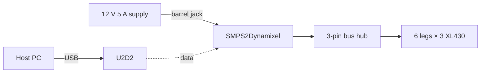
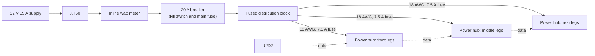

# Mayday hardware

## Responsibility

The physical build of Mayday, the hexapod: what it is made of, how it is wired and powered, and its **hardware revisions** (see [CONTEXT.md](../../CONTEXT.md)). The mechanical design is edited in Fusion 360; this folder holds what software and readers use ([ADR 0015](../../docs/adr/0015-fusion-is-the-cad-source-the-repository-holds-exports.md)).

## Revisions

The current revision is **A**. Later revisions are planned and not built. Each gets a Fusion milestone and a git tag `mayday-hw-<letter>` when it is built.

| Revision | Status | Change |
|---|---|---|
| A | Current | 12 V 5 A supply on a tether, one power feed |
| B | Planned | 12 V 15 A supply, a 20 A breaker as kill switch and main fuse, fused distribution into three power hubs, inline watt meter |
| C | Planned | 3S Li-ion battery with BMS, USB-C charging on board ([ADR 0017](../../docs/adr/0017-li-ion-battery-charged-on-board.md)) |
| D | Planned | Onboard computer, and a motor power switch it controls |
| E | Planned | Wireless charging nest |

## Bill of materials (revision A)

| Part | Count | Role |
|---|---|---|
| Robotis Dynamixel XL430-W250-T | 18 | Joint actuators, three per leg, TTL bus |
| Robotis U2D2 | 1 | USB to Dynamixel TTL bus, to the host PC |
| Robotis SMPS2Dynamixel | 1 | Feeds supply power into the bus |
| Robotis Dynamixel AX/MX 3-pin bus hub | 1 | Splits the bus to the legs |
| 12 V 5 A switching supply | 1 | Only power source |

## Wiring (revision A)

The host PC drives the bus through the U2D2. All 18 servos share one power feed through the SMPS2Dynamixel.

## Wiring (revision B, planned)

Three fused feeders, one per leg pair, so no single jack or hub carries all 18 servos. The breaker is both the kill switch and the main fuse. The battery of revision C plugs in at the XT60 connector; nothing after it changes.

## Power budget

| Load | Current at 12 V | Source |
|---|---|---|
| One XL430 at stall | 1.4 A | [Robotis e-Manual](https://emanual.robotis.com/docs/en/dxl/x/xl430-w250/) |
| 18 XL430 at stall | ~25 A | 18 × 1.4 A |
| 18 XL430 at standby, torque off | ~0.94 A (~11 W) | 18 × 52 mA |
| Average while walking | Not measured | Planned: watt meter in revision B |

Revision A's 5 A supply is far below the stall total. Servos reset on large, fast moves, which is why [`Driver`](../../Dynamixel/Driver.cs) limits velocity to 0.5 rev/s; a voltage drop is the suspected cause, not yet measured. XL430s report `PresentInputVoltage` but no current, so the current is measured outside them.

## Invariants

- Supply voltage stays between 6.5 V and 12.6 V. The XL430's rated operating range is 6.5–12.0 V; Robotis recommends a 3S Li-ion supply (11.1 V nominal) for it, which reaches 12.6 V when full, and the servos flag an input voltage error only above their Max Voltage Limit, 14.0 V by default ([`ControlRegister`](../../Dynamixel/ControlRegister.cs)). Revision C charges to 12.3 V ([ADR 0017](../../docs/adr/0017-li-ion-battery-charged-on-board.md)).
- No single connector, hub or cable is asked for more than its rating.

## Exports

Geometry exported from Fusion (STEP, STL) will live in `exports/`, stored with Git LFS, each commit naming its Fusion version. None exported yet.

## Related ADRs

[0015](../../docs/adr/0015-fusion-is-the-cad-source-the-repository-holds-exports.md), [0016](../../docs/adr/0016-the-csharp-structure-stays-the-kinematic-source.md), [0017](../../docs/adr/0017-li-ion-battery-charged-on-board.md)

## Related Findings

[Onboard charger and BMS candidates](../../knowledge/findings/onboard-charger-and-bms-candidates.md)

## Related Root Causes

[Rear femur hits the body](../../knowledge/root-causes/rear-femur-hits-body.md)
